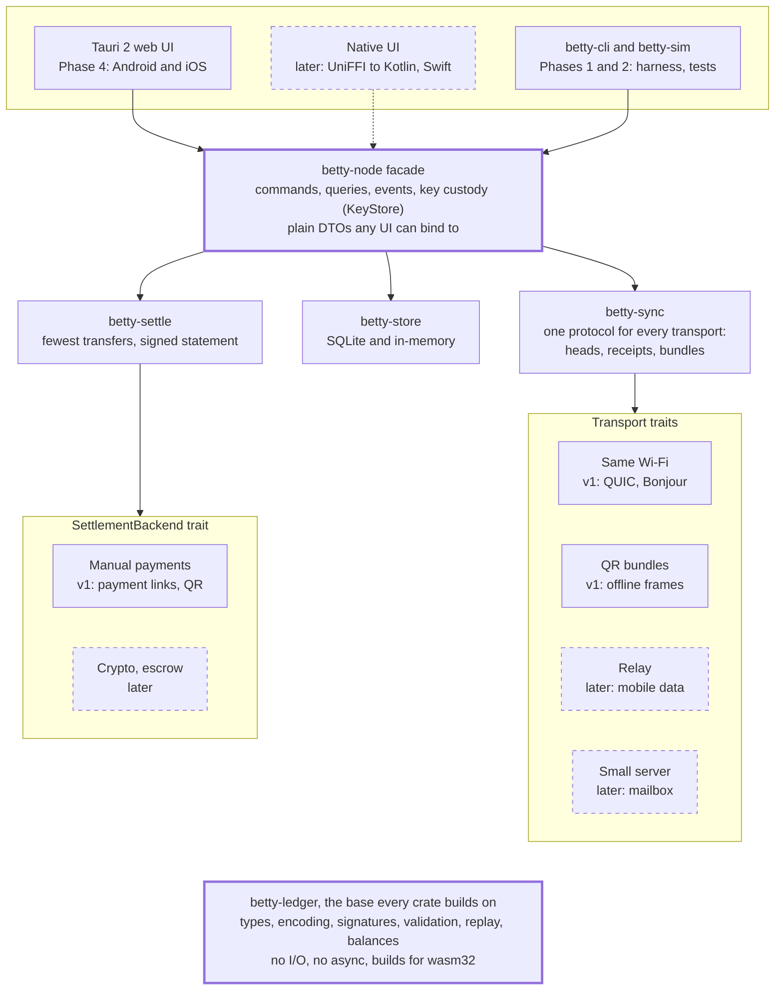
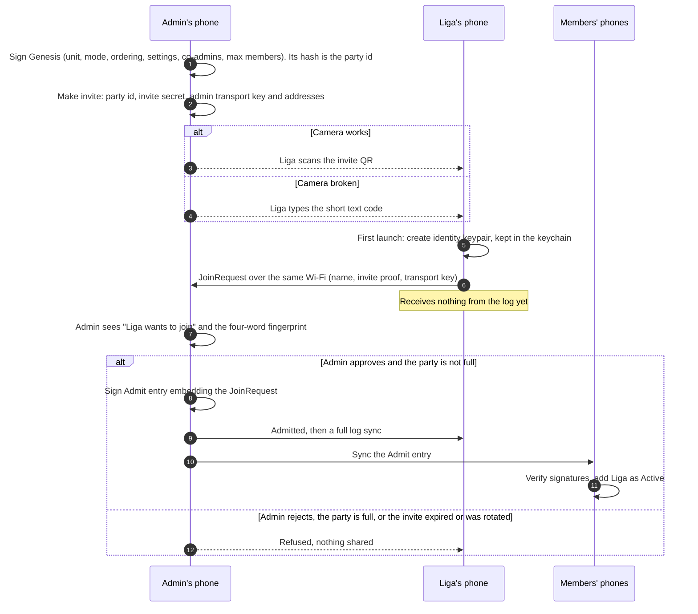
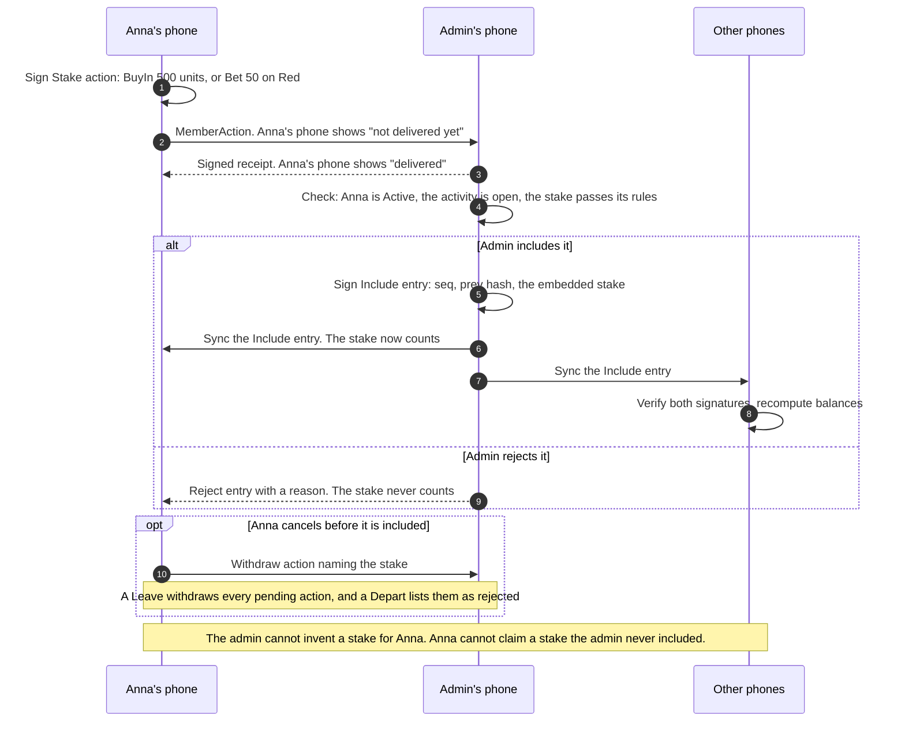
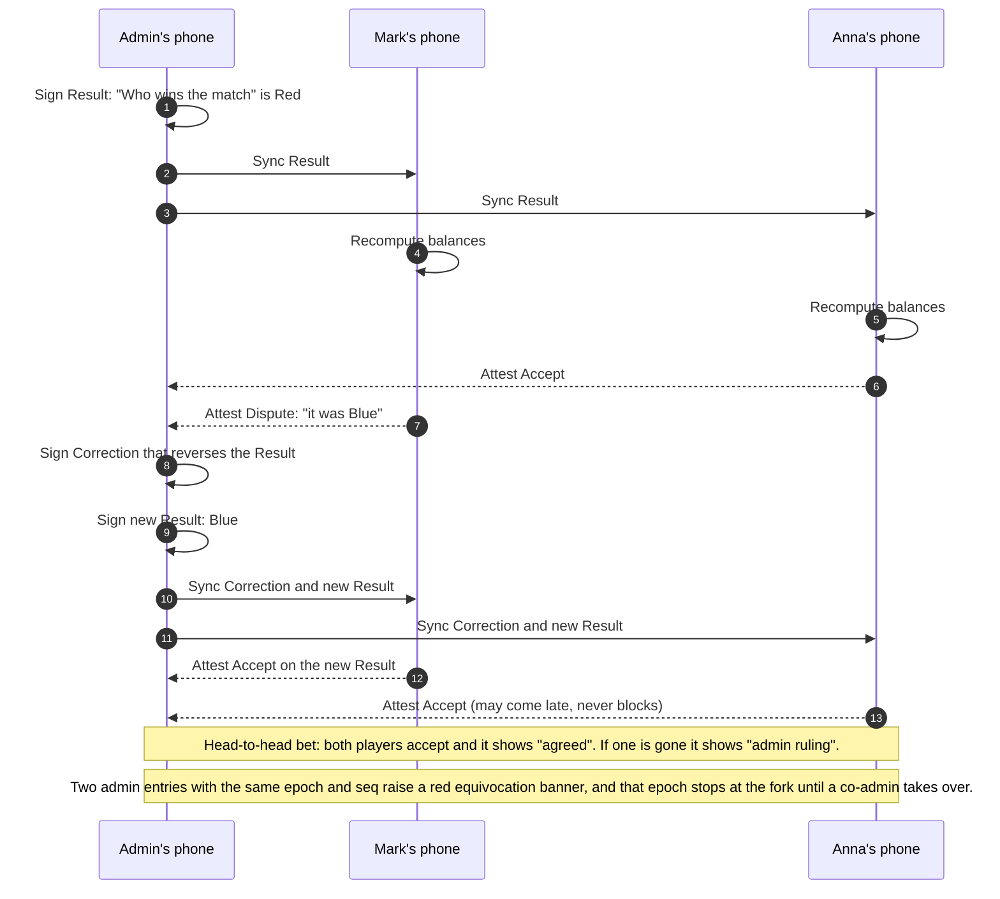
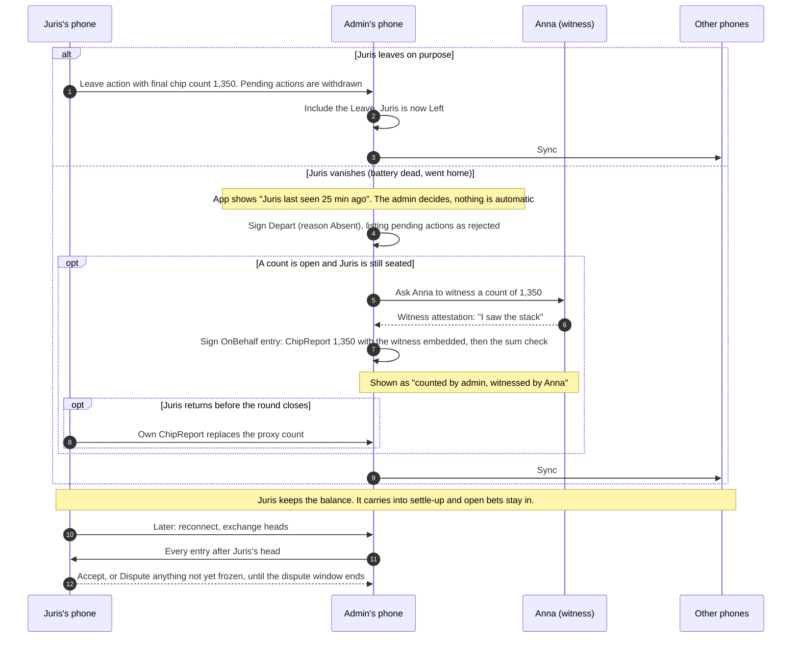
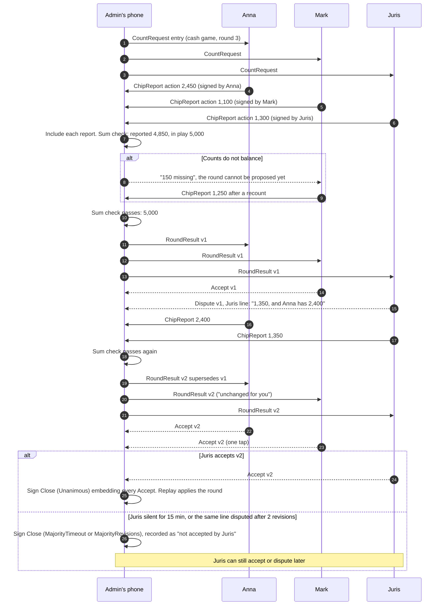
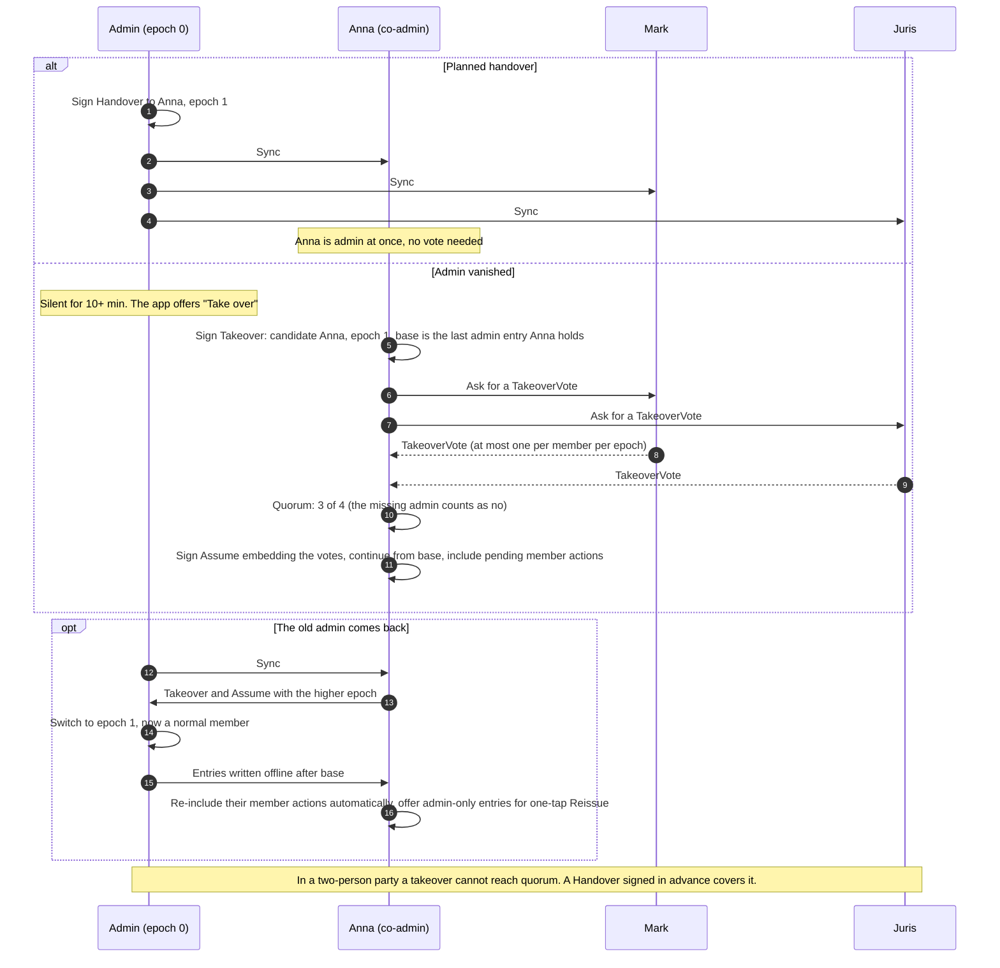
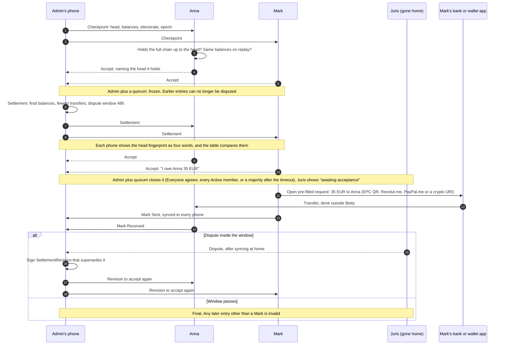
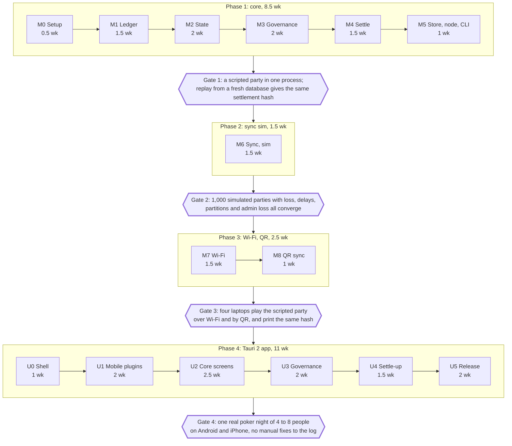

# Betty v1 technical design

2026-10-26. Claude Doc version: https://claude.ai/artifact/33c9FUTsG93ShbNMiDA4gt. The crate and roadmap diagrams below are Mermaid copies of the ones in the Claude Doc.

**Design 1.0**, completed on 26 October 2026. Later design changes are made in the repository copy, which is the source of truth from here on.

## Summary and scope

Betty v1 is a Rust core plus a Tauri 2 web UI that runs a poker night or betting party entirely on the players' phones, syncing over the same Wi-Fi or by QR, with no server of any kind. It is built in four phases, each ending in a gate: Phase 1 is the core with no networking (about 8.5 weeks for one developer, an estimate), Phase 2 the sync protocol tested in simulation (1.5 weeks), Phase 3 local networking over Wi-Fi and QR (2.5 weeks), and Phase 4 the Tauri 2 app for Android and iOS (11 weeks).

This design follows the accepted direction in the assessment and the diagrams: a signed, hash-chained log instead of a blockchain, one acting admin who writes the official chain, detached attestations that never block, two operating modes, dropout and takeover rules, and a settle-up that only pre-fills payments.

**In v1**

- Parties with an admin (playing or not), co-admins, QR join with admin approval, and no-phone members managed by the admin.
- Activities as four payout models: chip count (poker cash games and other chip or points games), places (tournaments of any game), pool (pari-mutuel bets) and head-to-head. Presets give each game its name and rules.
- Both modes: Admin + majority, and Everyone agrees with self-reported chip counts.
- Leave, Depart, proxy counts with a witness, planned handover, quorum takeover, equivocation detection.
- Checkpoints, settlement with the fewest transfers, a dispute window, revisions, and pre-filled payment requests (SEPA QR, Revolut, PayPal, crypto URIs).
- Transports: same-Wi-Fi peer-to-peer (including a phone hotspot) and QR sync for client-isolated networks.

**Possible later additions (not decided, may never be built; the design only keeps room for them)**

- A relay or small always-on server as a second transport, and browser joiners.
- A native UI on top of the same core.
- Direct crypto settlement, including an escrow contract.
- Odds set by a member (fixed-odds bets).
- Push notifications.
- Optional accounts (several devices per person, key backup, history across devices).
- Other features that need a backend, such as https invite links, joiner verification, cloud stats and encrypted backups.

**Out of scope**

- Holding money and taking fees. Neither is considered at this stage.

## Design principles and constraints

Every later section applies these eight rules; where a choice was close, the rule decided it.

1. **Phones are the system.** Each phone holds the full log of every party it belongs to and computes all balances itself. Reads never need the network.
2. **Only the acting admin waits on nobody.** Nothing that moves the party forward waits for anyone but the admin of the current epoch. Other signatures are either consent to a person's own money or non-blocking attestations.
3. **Append only.** Records are never edited or deleted. Corrections reverse, revisions supersede.
4. **Deterministic replay.** State is a pure function of the verified objects a phone holds. The same objects give the same bytes, hashes and balances on Android, iOS, desktop and later WebAssembly.
5. **Integer units only.** Balances are signed 64-bit integers in the party's unit. No floats anywhere in the core; ratios are integer fractions and every rounding rule is written down.
6. **The core knows nothing about the UI or the network.** The ledger crate does no I/O and has no async. Transport, discovery, storage, key custody and settlement are traits, so a relay, a native UI or a crypto backend plugs in without touching the ledger.
7. **The app never holds money.** Settlement produces a signed statement and payment requests the payer completes in their own app.
8. **Fail visible, never silent.** Missing updates, undelivered member actions, admin rulings, majority closes and equivocation all show on every phone.

**Platform constraints that shape the design**

- iOS suspends backgrounded apps, so sync runs while the app is in the foreground and catches up whenever two phones meet. No phone is a server.
- Venue and guest Wi-Fi often isolates clients from each other. QR sync and a phone hotspot are the fallbacks.
- iOS asks for Local Network permission, and raw multicast needs a special Apple entitlement. Discovery therefore goes through Bonjour on iOS and NSD on Android (see Sync).
- QR codes carry roughly 1 to 2 KB reliably per frame, so QR sync sends deltas, across several frames when needed.

## Architecture overview

The code is one Cargo workspace in layers: a pure ledger at the bottom, settlement, storage and sync around it, one `betty-node` facade that every UI talks to, and thin shells on top. Each arrow in the stack points down only, and every box marked as a trait is where a future relay, native UI or crypto backend plugs in.

*Crate layers and extension seams. Arrows point to what each layer calls; dashed boxes are possible later additions, not decided.*



The UI shells call only the facade; the relay, small server and crypto settlement arrive as new implementations of traits that already exist in v1.

| Crate | Phase | Responsibility | Depends on | Extension seam |
| --- | --- | --- | --- | --- |
| `betty-ledger` | 1 Core | Types, canonical encoding, hashing, signatures, record catalogue, validation, replay into party state, balances; built as an ordering layer that feeds a state layer | none (no I/O, no async, builds for wasm32) | `PublicKey` and `Signature` are algorithm-tagged enums |
| `betty-settle` | 1 Core | Fewest-transfers solver, settlement statement, payment request builders | ledger | `SettlementBackend` trait |
| `betty-store` | 1 Core | Persistence of objects, indexes and cached state; in-memory and SQLite implementations | ledger | `Store` trait |
| `betty-node` | 1 Core, sync wiring in 2 | The facade: commands, queries, event stream, key custody, wiring of store, settlement and later sync | ledger, settle, store (sync from Phase 2) | `KeyStore` trait; UI-neutral DTOs |
| `betty-cli` | 1 Core | Headless harness: one process holding several identities that pass objects to each other in memory; scripted parties | node | none |
| `betty-sync` | 2 Sync | Sync protocol messages and session state machine, head gossip, receipts, bundles, in-memory transport | ledger | `Transport`, `Connection`, `Discovery` traits |
| `betty-sim` | 2 Sync | Deterministic multi-node simulation with fault injection | node, sync | none |
| `betty-net-lan` | 3 Local network | Same-Wi-Fi transport and desktop mDNS discovery | sync | one `Transport` implementation |
| `betty-qr` | 3 Local network | Multi-frame QR encoding and decoding of sync bundles and invites | sync | none |
| `apps/betty` | 4 App | Tauri 2 shell, mobile plugins, web UI | node | Tauri commands wrap the node API |
| `betty-relay`, `betty-net-relay` | possible, not decided | Relay binary and relay transport | sync | second `Transport` |

**Why one facade.** The UI never touches ledger types directly. `betty-node` exposes plain commands (`create_party`, `approve_join`, `place_bet`, `attest`, `settle`), queries that return view structs (`PartyView`, `BalancesView`, `InboxView`, `SettlementView`) and a stream of events (`StateChanged`, `PeerSeen`, `SyncProgress`, `MissingUpdates`, `Equivocation`). The DTOs are plain records and enums with no generics or lifetimes, so the same API can be exposed through Tauri commands now and through UniFFI to Kotlin and Swift later.

**Why the ledger builds for WebAssembly.** The future browser join page will run the same validation and replay code, so phones and browsers can never disagree about a balance.

## Identity, keys and party model

A person is their device's signing key, a party is the hash of its Genesis record, and everything else hangs off those two ids.

**Keys per device**

| Key | Algorithm (v1) | Lifetime | Used for | Stored in |
| --- | --- | --- | --- | --- |
| Identity key | Ed25519 | Per device, long-lived | Signing member actions, entries, attestations, marks | iOS Keychain or Android Keystore-wrapped secret, via `KeyStore` |
| Transport key | Ed25519 (QUIC TLS identity) | Fresh per party | Authenticating sync connections | Same store, deleted when the party is archived |
| Wallet key (later) | Whatever the chain uses | Owned by the user's wallet app | Linking a payout address, signing an escrow statement | Never in Betty |

Public keys and signatures are tagged enums (`PublicKey::Ed25519([u8; 32])`), so a P-256 hardware-backed key or a secp256k1 wallet key can be added as a new variant without changing the wire format of existing ones. The transport key is separate from the identity key from day one, as Follow-up 4 recommends for the relay, so adding a relay later changes nothing about identity. A person is shown as their display name plus a fingerprint of four words derived from the identity key.

**Party**

- `PartyId` = BLAKE3 hash of the signed Genesis entry. Every object carries it, so objects can never be replayed into another party.
- **Unit.** Genesis names one unit: a code (`EUR`), its minor digits (2), and an optional display label. All balances are integer minor units. Chips are per activity, with an integer fraction `chip_value = num / den` units per chip.
- **Mode.** `AdminMajority` or `Unanimous` ("Everyone agrees"), fixed at Genesis.
- **Ordering.** `LogOrdering::AdminChain`, the only value in v1: the admin chain decides which records are accepted and in what order. It is a separate axis from the mode. The mode says who must agree before something takes effect; the ordering says who puts records in order. Genesis records both, and a phone that meets an ordering it doesn't know shows "update Betty".
- **Settings** with defaults: quorum rule majority, dispute window 48 h, round timeout 15 min, maximum revisions before majority close 2, takeover suggestion after 10 min of admin silence, isolate absent players on, per-party max buy-in optional.
- **Roles.** One acting admin per epoch, an ordered co-admin list (the successors offered for takeover), members.
- **Format version.** Genesis carries `format: u16`. A phone that meets a party with a newer format, or an entry kind it doesn't know, shows "update Betty to open this party" and never guesses.
- **Size limit.** Genesis carries `max_members: u16`, 16 in v1 and fixed for the party. Everyone ever admitted counts toward it, including the admin and members who left or were departed, because their balances still settle. The app writes its own `MAX_MEMBERS` constant into each new Genesis, so raising the cap later means changing that one constant: existing parties keep their limit, and a phone whose constant is lower than a party's `max_members` shows "update Betty to open this party", because every phone must run the same settlement solver for that party size.

**Members**

| Field | Values |
| --- | --- |
| `key` | identity public key |
| `kind` | `App`, `Managed` (no phone, every action entered by the admin and flagged), `Browser` (reserved for the relay era; cannot be admin, co-admin or witness) |
| `state` | `Active`, `Left`, `Departed` (computed from the log, never stored separately) |
| `profile` | display name, avatar colour, payout methods (IBAN, Revolut handle, PayPal.me, crypto addresses by chain) |
| `last_seen` | local hint only, from sync sessions; never part of the log |

**Joining, step by step.** The joiner sees nothing from the log until the admin signs an `Admit`, and a full party refuses new requests.



**Activities** are opened by the admin inside a party. An activity's kind is a payout model rather than a particular game, so one model serves poker, darts or a pub quiz alike, and presets (below) give each game its name and rules. Its parameters say how it pays out; its rules (next) say who may stake what and when. The parameters are one enum, and strum generates `ActivityKind` from it, so a kind can never carry another kind's parameters:

```rust
// Activity kinds are payout models, not games; presets give each game its name and rules.
#[derive(BorshSerialize, BorshDeserialize, Serialize, Deserialize, EnumDiscriminants)]
#[strum_discriminants(name(ActivityKind))]
#[strum_discriminants(derive(BorshSerialize, BorshDeserialize, Serialize, Deserialize,
                             PartialOrd, Ord, Hash, EnumIter))]
enum ActivityParams {                       // append-only, like Rule
    ChipCount { chip_value: Ratio },        // stakes buy chips; paid by final count x chip value
    Places { payouts: Vec<PayoutTier> },    // pool paid by finishing order; the split depends on players
    Pool { question: String, outcomes: Vec<String> },  // pari-mutuel: backers of the winner share the pool
    HeadToHead { claim: String },           // two players, matched stake; players and stake are rules
}
impl ActivityParams { fn kind(&self) -> ActivityKind { ActivityKind::from(self) } }

struct PayoutTier {                         // one row of a Places payout chart, fixed at open
    min_players: u16,                       // applies from this many players up to the next tier
    payout_bps: Vec<u16>,                   // index = place, basis points summing to 10,000
}

struct Activity {                           // fixed at OpenActivity, except rules and windows
    id: ActivityId,                         // hash of the OpenActivity entry: unique, unforgeable
    name: String,                           // "Friday sit-n-go"
    game: Option<String>,                   // "Poker", "Darts": display and cross-party stats only
    params: ActivityParams,
    rules: RuleSet,
    open_windows: BTreeSet<RuleKind>,
}
```

Buy-in amounts, rebuys, add-ons, the head-to-head players and stakes are not parameters: they are rules, so they change through the same actions in every activity.

**Parameters in detail**

- **`ChipCount { chip_value }`**: units per chip as an integer fraction, for poker cash games or any game whose chips or points convert to money at a fixed rate. With a EUR party (units are cents), 1 chip = 0.10 EUR is `Ratio { num: 10, den: 1 }`.
- **`Places { payouts }`**: the payout chart for any ranked competition, such as a poker tournament, a darts knockout or a pub quiz. Each `PayoutTier` gives a split, `payout_bps`, and the number of players from which it applies. In a split, index 0 is first place and each value is that place's share of the prize pool in basis points (1 bp = 0.01%, 10,000 = 100%): `[5000, 3000, 2000]` pays 50/30/20 and `[10000]` is winner takes all. Basis points keep the core free of floats while still allowing splits such as 62.5/37.5 or 33.33/33.33/33.34.
  - The chart is set when the activity opens and is fixed from then on, like every parameter. When the `Result` comes in, every phone uses the last tier whose `min_players` is at most the number of players. A player counts once they have bought in, only once however many times they re-enter, and still counts after leaving; rebuys, add-ons and re-entries only grow the pool. Example chart: 1 to 5 players pay 65/35, 6 to 10 pay 50/30/20, and 11 or more pay 40/25/18/10/7. A chart with one tier is a single fixed split.
  - The prize pool is every buy-in, rebuy and add-on in the activity. Place i gets pool × `payout_bps[i]` / 10,000 from the chosen tier, with the rounding rule in Balances. Six players at 20 make a pool of 120, which the example chart's second tier pays as 60, 36 and 24.
  - If fewer players finish than there are paid places, the unfilled places' shares are split among the paid places in proportion to their shares: 50/30 with two finishers becomes 62.5/37.5. Leaving the party or being departed never changes a player's standing, because Betty never works out a placing by itself: the admin's result places every entrant, including players who have gone home. In poker their stack stays at the table and is blinded off, so they finish wherever it runs out, and a share in the money reaches them through settle-up. A forfeited darts match or a quiz team that leaves early is recorded the same way, as an ordinary result. Ties and deals (two players tied for second, a chopped final table) are not handled in v1; tied players sharing the payouts of the places they cover is the natural later addition.
- **`Pool { question, outcomes }`**: `question` is the text every phone shows ("Who wins tonight's match?"), and `outcomes` are the possible answers (`["Latvia", "Estonia", "Draw"]`).
  - An outcome is identified by its index (`OutcomeIndex = u16`): a bet stores `outcome: 1`, the `Result` stores the winning index, and `PlayerTally.outcomes_backed` holds indexes. The text is for display only; no rule or balance reads it.
  - Because bets point at indexes, outcomes are fixed once the activity is opened. If one is missing, the admin voids the bet (everyone is refunded) and opens a corrected one.
  - Payout is pari-mutuel: the winners split the whole pool in proportion to their stake on the winning outcome. If nobody backed the winner, or the bet is voided, everyone is refunded. Example: Anna 10 and Juris 30 on Latvia, Mark 20 on Estonia. Latvia wins, so the pool of 60 pays Anna 15 and Juris 45; the nets are +5, +15 and −20.
- **`HeadToHead { claim }`**: display text ("Mark can't finish a pint in 10 seconds"). The `Result` names which of the two allowed players won.

**Limits checked at `OpenActivity`**, to keep records small enough for QR sync. Lengths are counted in Unicode characters (scalar values), so every phone gets the same count.

| Field | Limit |
| --- | --- |
| Activity name | 1 to 60 characters |
| `game` label | Optional, 1 to 40 characters; compared case-insensitively for stats |
| `question`, `claim` | 1 to 200 characters |
| `outcomes` | 2 to 16 entries, each 1 to 60 characters, no duplicates |
| `payouts` | 1 to 8 tiers, the first with `min_players` 1 and each later one higher; each tier's `payout_bps` has 1 to 16 places, each value 1 to 10,000, summing to exactly 10,000 |
| `chip_value` | numerator and denominator each 1 to 1,000,000 |

**Activity rules.** Each activity holds a set of modular rules keyed by rule kind, and one rule engine checks every stake the same way whatever the activity. The admin sets the rules in `OpenActivity`, starting from a template for the activity's kind, so for example a player cannot buy into the same sit-n-go twice unless a rebuy rule is present. Rules are part of the signed log, so every phone enforces the same limits.

```rust
// One type per rule kind, each in its own module with its own checks and tests.
struct BuyIn(AmountRule);               // amount of the first entry
struct MaxEntries(u8);                  // entries per player; 1 = no re-entry
struct Rebuy(RepeatRule);
struct AddOn(RepeatRule);
struct MaxPlayers(u16);
struct StakeCap(u64);                   // per player, all stakes in this activity
struct BetAmount(AmountRule);
struct MaxBets(u8);                     // stakes per player on a Pool
struct OneOutcomePerPlayer;
struct AllowedPlayers(Vec<PublicKey>);

// Shared building blocks.
enum AmountRule { Fixed(u64), Range { min: u64, max: u64 } }
struct RepeatRule { amount: AmountRule, max_count: Option<u8> }  // None = unlimited

// The closed set that is signed and stored. strum generates RuleKind:
// the same variants without data, plus From<&Rule> for RuleKind.
// Variants are append-only: Borsh writes the variant number, and numbers are never reused.
#[derive(BorshSerialize, BorshDeserialize, Serialize, Deserialize, EnumDiscriminants)]
#[strum_discriminants(name(RuleKind))]
#[strum_discriminants(derive(BorshSerialize, BorshDeserialize, Serialize, Deserialize,
                             PartialOrd, Ord, Hash, EnumIter))]
enum Rule {
    BuyIn(BuyIn), MaxEntries(MaxEntries), Rebuy(Rebuy), AddOn(AddOn),
    MaxPlayers(MaxPlayers), StakeCap(StakeCap), BetAmount(BetAmount),
    MaxBets(MaxBets), OneOutcomePerPlayer(OneOutcomePerPlayer),
    AllowedPlayers(AllowedPlayers),
}
impl Rule { fn kind(&self) -> RuleKind { RuleKind::from(self) } }

struct RuleSet(BTreeMap<RuleKind, Rule>);  // held by Activity (above)
```

**Enum with data rather than (key, value) pairs.** The key is derived from the variant, so a `Rebuy` key can never hold an add-on's settings. On the wire the set is a list sorted by kind with no duplicates, and the decoder rejects anything else, so every phone produces the same bytes, which a `HashMap` would not guarantee. In memory it is a map.

**The same actions for every activity.** Rules change only through one admin entry, `AmendRules { activity, changes }`, and the possible changes are the same four for every activity:

| Change | Effect |
| --- | --- |
| `Set(Rule)` | Adds the rule, or replaces the one of the same kind |
| `Remove(RuleKind)` | Drops the rule |
| `OpenWindow(RuleKind)` | Opens the time window of a windowed rule: `BuyIn` (registration and late entry), `Rebuy`, `AddOn`, `BetAmount` (betting) |
| `CloseWindow(RuleKind)` | Closes it; `LockActivity` closes every window at once |

Several changes in one entry apply together, from the moment they take effect onward, never to stakes already included. Every phone shows the change.

```rust
struct AmendRules {
    activity: ActivityId,
    changes: Vec<RuleChange>,
    supersedes: Option<EntryId>,   // a revised proposal after a dispute (Everyone agrees)
}
enum RuleChange { Set(Rule), Remove(RuleKind), OpenWindow(RuleKind), CloseWindow(RuleKind) }
```

**Who approves a change depends on the mode.**

- **Admin + majority:** every change takes effect when the admin signs `AmendRules`. Players can dispute it afterwards, like a result.
- **Everyone agrees:** `Set` and `Remove` change the deal everyone is playing under, so they work like a round result. The admin's `AmendRules` is a proposal, every Active member accepts or disputes it, and a dispute leads to a revised `AmendRules` that supersedes it. The change takes effect only at the `Close` entry that records every Active member's acceptance, with the same escape hatches: a majority close after 15 minutes of silence or after two disputed revisions, recorded with who did not accept. Until then the activity carries on under the current rules, so play never waits.
- **Window changes, both modes:** `OpenWindow` and `CloseWindow` take effect when the admin signs them, with no vote. They only time rules everyone already agreed to, and waiting for acceptance before closing betting would let bets in after the match has started. In Everyone agrees mode one `AmendRules` holds either window changes or `Set`/`Remove`, never both, so an entry is either immediate or voted.
- **Starting rules, both modes:** the rules in `OpenActivity` need no vote. A player agrees to them by staking, and nobody is bound before their first stake.

**Example: a rebuy tournament.**

1. `OpenActivity` (filled in from the Rebuy tournament preset) sets a fixed buy-in of 20, one entry per player, up to 2 rebuys of 20 and one add-on, with the registration and rebuy windows open.
2. Cards are dealt: `AmendRules [CloseWindow(BuyIn)]` stops late entries.
3. The group wants a third rebuy: `AmendRules [Set(Rebuy(RepeatRule { amount: Fixed(20), max_count: Some(3) }))]`. With Admin + majority it applies at once; with Everyone agrees it applies once every Active member has accepted it.
4. Break after level 4: `AmendRules [CloseWindow(Rebuy), OpenWindow(AddOn)]` ends rebuys and opens add-ons in one entry.
5. After the break: `AmendRules [CloseWindow(AddOn)]`.

For a pool bet, `CloseWindow(BetAmount)` stops betting when the match starts. `LockActivity` closes every window at once.

**One type per rule kind, with its checks on that type.** Each rule kind is its own type in its own module and implements one trait. `Rule` is only the closed set that gets signed and stored. To run a check it lends out the inner value as `&dyn RuleCheck` through a single `as_check` match, and every method goes through that match, so adding a rule kind means one new type, one enum variant and one match line, with no macro or extra crate.

```rust
trait RuleCheck {
    fn kind(&self) -> RuleKind;
    fn windowed(&self) -> bool { false }                       // can CloseWindow pause this rule?
    fn applies_to(&self, stake: StakeKind) -> bool;            // e.g. Rebuy applies only to Rebuy stakes
    fn check(&self, ctx: &StakeCtx) -> Result<(), Violation>;  // the stake, the player's tally,
}                                                              // the activity's tally, open windows

impl RuleCheck for Rebuy {
    fn kind(&self) -> RuleKind { RuleKind::Rebuy }
    fn windowed(&self) -> bool { true }
    fn applies_to(&self, stake: StakeKind) -> bool { stake == StakeKind::Rebuy }
    fn check(&self, ctx: &StakeCtx) -> Result<(), Violation> {
        ctx.require_window(self.kind())?;
        ctx.require_amount(&self.0.amount)?;
        ctx.require_count(StakeKind::Rebuy, self.0.max_count)
    }
}

// The enum is what is stored; &dyn RuleCheck is only borrowed from it to run a check.
impl Rule {
    fn as_check(&self) -> &dyn RuleCheck {
        match self {
            Rule::BuyIn(r) => r,
            Rule::Rebuy(r) => r,
            // one line per variant; a missing variant does not compile
        }
    }
    fn windowed(&self) -> bool { self.as_check().windowed() }
    fn applies_to(&self, stake: StakeKind) -> bool { self.as_check().applies_to(stake) }
    fn check(&self, ctx: &StakeCtx) -> Result<(), Violation> { self.as_check().check(ctx) }
}
```

- `Rebuy` and `AddOn` share `RepeatRule` as data but are separate types, so each has its own checks and can diverge later without touching the other.
- The shared checks (window open, amount within the rule, count under the limit) live on `StakeCtx`, so every rule uses the same code for the same kind of check.
- The newtypes cost nothing in the log: Borsh writes a one-field struct as just its field, so the bytes are the same as a plain enum.
- Rules are stored as the closed enum, never as `Box<dyn RuleCheck>`. A boxed trait object can't be decoded from the log without a hand-written type registry, an open set would let phones disagree about which rules exist, a `match` on the enum fails to compile when a variant is missing, and the enum gets serialize, compare, clone and display from derives. `&dyn RuleCheck` is only ever a short borrow from the enum while a check runs, so the trait must stay dyn-compatible: methods instead of associated constants, and no generic methods. A unit test checks that every variant's `as_check().kind()` equals its `RuleKind`.

The engine runs every rule that applies to the stake and collects all violations, so the admin's phone can say exactly why a stake was refused ("Juris already has 1 entry, maximum 1"). A stake that breaks a rule is invalid during replay even if the admin includes it, so the admin cannot bypass the rules either.

**What this pattern is called.** Two established names describe it, and "rule engine" in this doc means only this:

- **Specification pattern** (Domain-Driven Design, Evans and Fowler): each rule is a small object that answers "does this candidate satisfy me?", and a candidate is valid when every specification passes. Each `RuleCheck` type is a specification, and the candidate is a stake with its `StakeCtx`.
- **Consensus rules** (a ledger term; some chains say validity predicates): rules that every node evaluates identically to accept or reject an entry. Betty's rule checks are consensus rules because every phone runs them during replay, which is why a stake that breaks one is invalid even when the admin included it.
- It is not a **rules engine** in the usual sense, where rules are data that can change without recompiling (as in Drools). See "Why rule logic is not configurable" below.

**Stakes and the rules that check them.** A stake kind is what a player does with money; a rule kind is a limit the admin sets. They are separate enums on purpose. The link between them is many-to-many, and each enum grows on its own in the log, so a new limit never creates a stake nobody can make and a new stake never creates a rule with nothing to check.

```rust
// What a Stake action does. strum derives StakeKind: the same variants without data.
#[derive(BorshSerialize, BorshDeserialize, Serialize, Deserialize, EnumDiscriminants)]
#[strum_discriminants(name(StakeKind))]
#[strum_discriminants(derive(BorshSerialize, BorshDeserialize, Serialize, Deserialize,
                             PartialOrd, Ord, Hash, EnumIter))]
enum StakeAction {                          // append-only, like Rule
    BuyIn, Rebuy, AddOn,
    Bet { outcome: OutcomeIndex },
}
struct Stake { activity: ActivityId, action: StakeAction, amount: u64 }

impl StakeKind {
    // Exhaustive: a new stake kind does not compile until it names its permitting rule.
    fn permitting_rule(self) -> RuleKind {
        match self {
            StakeKind::BuyIn => RuleKind::BuyIn,
            StakeKind::Rebuy => RuleKind::Rebuy,
            StakeKind::AddOn => RuleKind::AddOn,
            StakeKind::Bet => RuleKind::BetAmount,
        }
    }
}
```

- **Every stake kind has exactly one permitting rule.** It allows the stake, sets its amount and keys its window: `OpenWindow(Rebuy)` opens rebuys and `CloseWindow(BetAmount)` stops betting. The names match for buy-ins, rebuys and add-ons; a bet's permitting rule is `BetAmount`.
- **The engine checks a stake in two steps.** First the activity must hold the permitting rule for the stake's kind, or the stake is refused as not allowed ("this activity has no rebuys"). Then every rule whose `applies_to` matches runs its check.

Which rules check each stake kind, from each rule's `applies_to`:

| Stake kind | Permitting rule | Also checked by |
| --- | --- | --- |
| `BuyIn` | `BuyIn` | `MaxEntries`, `MaxPlayers`, `StakeCap`, `AllowedPlayers` |
| `Rebuy` | `Rebuy` | `StakeCap`, `AllowedPlayers` |
| `AddOn` | `AddOn` | `StakeCap`, `AllowedPlayers` |
| `Bet` | `BetAmount` | `MaxBets`, `OneOutcomePerPlayer`, `StakeCap`, `AllowedPlayers` |

**What a missing rule means.** A missing permitting rule means "not allowed" (no `Rebuy` rule, no rebuys). A missing limit means "no limit" (no `StakeCap`, no cap). This is fixed per rule kind, so replay never guesses.

**Activity kinds only declare a schema:** which rules are required, which are allowed, and the template the admin starts from.

| Activity kind (payout model) | Required | Also allowed | Default template |
| --- | --- | --- | --- |
| `ChipCount` | `BuyIn` | `Rebuy`, `MaxPlayers`, `StakeCap`, `AllowedPlayers` | Buy-in range, unlimited rebuys with the window open, registration open |
| `Places` | `BuyIn` (fixed), `MaxEntries` | `Rebuy`, `AddOn`, `MaxPlayers`, `AllowedPlayers` | Fixed buy-in, one entry, no rebuys |
| `Pool` | `BetAmount` | `MaxBets`, `OneOutcomePerPlayer`, `StakeCap`, `AllowedPlayers` | Amount range, one bet per player, one outcome per player |
| `HeadToHead` | `AllowedPlayers` (two), `BetAmount` (fixed), `MaxBets` (1) | none | The two players and the agreed stake |

`AmendRules` is refused if it removes a required rule or adds one the activity kind doesn't allow.

**New rule kinds later.** Each rule kind records the format version that introduced it. A phone that meets a rule kind it doesn't know shows "update Betty" for that party rather than skipping the rule, because skipping would change which stakes count. The UI renders rules generically, with one editor per config type (amount, count, player list), so a new rule kind needs at most one new editor.

**Alternatives considered.** A fixed struct of optional fields, the earlier draft, is simpler, but every new rule changes it and activities can't opt in and out cleanly. A small expression language ("rebuys at most 3 while the window is open") is the most flexible, but it is hard to validate, to explain on screen and to keep identical across app versions. The enum-keyed rule set sits between the two.

One thing stays with the admin: the app can't tell whether a player has really run out of chips before a rebuy, so that is the admin's call when including it.

**Running totals.** An activity is never stored as a record of its own. Every phone rebuilds it by replaying the log and keeps running totals beside it, which the rule checks and the balance rules read:

```rust
struct ActivityState {
    activity: Activity,
    status: ActivityStatus,                     // Open | Locked | Resulted | Voided
    players: BTreeMap<PublicKey, PlayerTally>,
    pool: u64,                                  // units staked in total
    chips_in_play: u64,                         // chip games: buy-ins, rebuys and add-ons in chips
    rounds: Vec<RoundState>,                    // counts and round results (Everyone agrees)
    pending_amend: Option<EntryId>,             // a voted rule change waiting for its Close
    outcome: Option<Outcome>,                   // winning outcome, places or winner
}

struct PlayerTally {
    entries: u8, rebuys: u8, add_ons: u8, bets: u8,
    staked: u64,                                // units, all stakes in this activity
    outcomes_backed: BTreeSet<u16>,             // Pool
    cashed_out: Option<u64>,                    // chips, ChipCount
    seated: bool,                               // bought in, not cashed out, not left
}
```

| Entry | Effect on the activity |
| --- | --- |
| `OpenActivity` | Creates it with its parameters, starting rules and open windows |
| `Include` of a stake | Runs the rule checks, then updates the player's tally, the pool and the chips in play |
| `AmendRules` | Changes rules or windows; in Everyone agrees mode a `Set` or `Remove` only sets `pending_amend` |
| `Close` | Applies a voted rule change or closes a round |
| `LockActivity` | Closes every window; status Locked |
| `Result`, `Void`, cash-outs | Set the outcome or the cash-outs; status Resulted or Voided |
| `Correction` | Replay drops the reversed entry's effect and recomputes the totals |

`StakeCtx` is what every rule check receives: a short-lived, read-only view of this state plus the stake being checked.

```rust
struct StakeCtx<'a> {
    member: &'a PublicKey,        // who made the stake (the action's signer)
    stake: &'a Stake,             // activity, action (kind and outcome), amount
    player: &'a PlayerTally,      // their entries, rebuys, bets and total staked so far
    activity: &'a ActivityState,  // pool, seated players, open windows, status
    settings: &'a Settings,       // party settings from Genesis, e.g. the max buy-in
}
// Shared helpers every rule uses: require_window, require_amount, require_count, ...
```

1. The state layer receives an accepted `Stake` (in v1, unwrapped by the ordering layer from an `Include` entry).
2. It looks up the activity's `ActivityState`, the member's `PlayerTally` (empty on their first stake) and the party `Settings`, all as replay has built them up to this entry.
3. It borrows them into a `StakeCtx`, checks the permitting rule, runs every rule whose `applies_to` matches, and drops the view.
4. Only if every check passes does replay update the tally, the pool and the chips in play.

The same checks run before anything is signed: the player's phone uses them to grey out a stake that would fail, and the admin's phone to show why a stake can't be included. `StakeCtx` is never stored, signed or synced, and because it is read-only a rule can only accept or refuse a stake, never change state.

**Presets.** A preset is a named, ready-made activity: a game label, parameters, starting rules and open windows. It is plain data, read with serde into the same types as above, so it can only combine existing payout models and rule kinds and never adds behaviour.

```yaml
name: Friday rebuy tournament
game: Poker
params:
  Places:
    payouts:
      - { min_players: 1,  payout_bps: [6500, 3500] }
      - { min_players: 6,  payout_bps: [5000, 3000, 2000] }
      - { min_players: 11, payout_bps: [4000, 2500, 1800, 1000, 700] }
rules:
  - BuyIn: { Fixed: 2000 }
  - MaxEntries: 1
  - Rebuy: { amount: { Fixed: 2000 }, max_count: 2 }
  - AddOn: { amount: { Fixed: 2000 }, max_count: 1 }
open_windows: [BuyIn, Rebuy]
```

- **Built-in presets** ship with the app: poker cash game, sit-n-go, rebuy tournament, match winner (`Pool`), side bet (`HeadToHead`) and darts knockout (`Places`).
- **Admins** can adjust a preset before opening, save their own, and share presets as a file or a QR code.
- **Picking a preset** fills in a normal `OpenActivity`, which then passes the usual schema and limit checks. The log never refers to the preset, so changing or deleting a preset never affects a party.
- **Amounts** are stored with the unit the preset was saved in. Using a preset in a party with a different unit asks the admin to confirm the amounts.
- **Format.** Presets are an import format only, never what is signed or synced. YAML, TOML or JSON is chosen when presets are built; the main Rust YAML crate, `serde_yaml`, is no longer maintained.

**Why rule logic is not configurable.** Defining new rule or payout behaviour in config files was considered and rejected for now. The definition would have to travel in the signed log, making its interpreter part of the protocol; payout formulas from a file could break the sum-to-zero guarantee; the UI could not explain arbitrary logic; and every phone would still need an app update to understand it. If it is ever needed, it can be added as one more `Rule` variant holding a small, limited expression (for example the CEL language), with its own format version.

## Ledger format

The log is four kinds of signed object: admin **entries** form the one ordered chain, member **actions** are signed by their owner and embedded in an entry when included, **attestations** are detached Accept or Dispute notes, and **marks** record payments after settlement. Only entries have an order; the other three are content-addressed and can arrive in any order.

```rust
struct Signed<T> { body: T, signer: PublicKey, sig: Signature }

struct Entry {             // admin chain, one writer per epoch
    party: PartyId,
    epoch: u32,            // 0 = creator, +1 per handover or takeover
    seq: u64,              // strictly +1 across the whole chain, never resets
    prev: Hash,            // id of the previous entry (zero for Genesis)
    at: Timestamp,         // admin clock, ms since epoch, >= prev.at
    body: EntryBody,       // see the catalogue
}

struct MemberAction {      // signed by the member it concerns
    party: PartyId,
    nonce: u64,            // per signer, makes ids unique
    at: Timestamp,
    body: MemberActionBody,
}

struct Attest {            // detached, never blocks
    party: PartyId,
    target: Hash,          // entry or member action id; versions are separate entries
    verdict: Verdict,      // Accept | Dispute { line, suggestion, note } | Witness | TakeoverVote
    holds_head: Option<Head>,    // required when attesting a checkpoint or settlement
}

struct Mark {              // after settlement, detached
    party: PartyId,
    transfer: Hash,
    status: Sent | Received | Waived,
    evidence: Option<String>, // e.g. bank reference, tx hash later
}
```

**What each object is for.**

- **`Signed<T>`** wraps every object: the body, the signer's public key and an Ed25519 signature. An object's id is the hash of the whole envelope (see Hashing and Signing below). Other objects refer to it by that id, so changing one byte changes the id.
- **`Entry`** is one link in the admin's chain, the only ordered history.
  - `epoch` is the admin's term: 0 for the creator, and each `Handover` or `Takeover` starts the next epoch with a new key. An entry counts only if the holder of its epoch signed it.
  - `seq` is its position, +1 every time and never reset. Two different entries with the same `seq` in one epoch prove a rewrite (see Equivocation).
  - `prev` is the previous entry's id, which makes the entries a hash chain: altering an old entry breaks every later one.
  - `at` is the admin's clock, used for display and timeouts; it never goes backwards.
  - `body` is what happened, from the entry catalogue: `OpenActivity`, `Include`, `Result`, `Depart`, `Checkpoint`, `Settlement` and so on.
- **`MemberAction`** is something a member does or asks for, signed by that member: a `Stake`, `ChipReport`, `CashOut`, `Leave` or another kind from the member action catalogue. It counts only once the admin embeds it in an `Include` entry, so a stake carries two signatures: the player's "I want this" and the admin's "it's in". The admin cannot invent a stake for someone, because they cannot forge that member's signature. `nonce` keeps two identical actions, such as two rebuys of 20, distinct.
- **`Attest`** is a member's note about an existing entry or member action, pointing at it by `target` id. `Accept` or `Dispute` agrees with it or flags it and never blocks anything; `Witness` confirms a proxy chip count; `TakeoverVote` supports a co-admin's takeover. A corrected result is a new entry, so an Accept always refers to one exact version. `holds_head` names the latest entry the signer holds; it is required on a checkpoint or settlement, so nobody can sign off history they have not seen.
- **`Mark`** tracks one transfer from the final settlement: the payer marks it `Sent`, the payee `Received` or `Waived`. `evidence` is an optional reference such as a bank reference, or a transaction hash if crypto settlement is ever added. Marks are detached because payments happen after the party, in any order.
- Every object carries `party`, so it can never be replayed into another party.

**A stake, step by step.** The receipt shows the action arrived; only the `Include` entry makes it count.



**The same objects in both modes.** Both modes use these four objects and nothing else; they differ only in which entries need the members' Accepts before replay applies them.

- **Admin + majority:** a `Result`, `RoundResult` or `AmendRules` takes effect when the admin signs it. Attestations are optional: an Accept is a personal sign-off, and a Dispute flags the entry for a `Correction`.
- **Everyone agrees,** for a chip count:
  1. The admin writes a `CountRequest` entry.
  2. Each player signs a `ChipReport` action with their own count, and the admin includes it.
  3. Once the counts add up to the chips in play, the admin writes a `RoundResult` entry.
  4. Every Active member signs an `Accept` attestation targeting that exact version, or a `Dispute`, which leads to a new version that supersedes it.
  5. The admin writes a `Close` entry that embeds the Accepts, or records a majority close after the timeout or two revisions. Replay applies the round only once that `Close` is in the chain.
- Rule changes (`Set`, `Remove`) in Everyone agrees follow the same path, with `AmendRules` in place of `RoundResult`.

**Encoding.** Every object is encoded with Borsh (the `borsh` crate), whose spec gives each value exactly one encoding, under strict rules:

- Structs only; no floats, no `usize` and no `HashMap` (ordered `BTreeMap` or sorted `Vec` only).
- Integers are fixed-width little-endian, a `bool` must be 0 or 1, strings are length-prefixed UTF-8 checked on decode, and fixed arrays such as `[u8; 64]` signatures are written as they are.
- Each enum writes its variant number as one byte. Variants use explicit numbers (`#[borsh(use_discriminant = true)]`) where the derive supports it and declaration order otherwise; either way they are only appended and a number is never reused.
- A one-byte object-type tag goes in front of every object.
- Ledger types derive Borsh for the log, and serde only for presets and the data passed to the UI. Internal types such as `Accepted`, `StakeCtx` and `ActivityState` are never encoded.

Golden test vectors (bytes, hash, signature) are checked into the repo and run on Android, iOS, desktop and wasm32 in CI, so a serializer change that alters bytes fails the build.

**Why Borsh.** It was chosen over postcard, the first candidate, with the possible future additions in mind:

- **Possible escrow.** Solana programs read Borsh natively and verify Ed25519 cheaply, so a Solana escrow could check Betty's own signed settlement statement as it is. EVM chains would use the separate EIP-712 form described under Possible future extensions either way.
- **Parts not written in Rust.** A bot admin, a mailbox server, an account service or league tools might not all be Rust. Borsh has a written spec and implementations in TypeScript, Go, Python, Java and other languages; postcard is mostly Rust only.
- **One encoding per value by design.** With postcard, Betty's own rules and tests would carry that guarantee alone. With Borsh the format's spec carries it and the tests confirm it.
- **Stable enum numbers.** Through serde, postcard always numbers variants in declaration order. Borsh can use explicit numbers, which makes append-only less fragile.
- **Costs.** Records are roughly 10 to 20% larger because integers are fixed-width, so QR sync needs slightly more frames; most of each record is 32-byte keys and 64-byte signatures anyway. Ledger types also carry a second set of derives.
- **Also considered.** Protobuf is not canonical and silently drops unknown fields, so an old phone could ignore a field that changes meaning; it stays a good fit for any future server API. Deterministic CBOR (DAG-CBOR) is standardized but larger, with more rules to get right. bincode changed its byte format between major versions. FlatBuffers and Cap'n Proto are built for zero-copy speed, not for unique bytes.
- Leaderless mode, the relay, a native UI and public proof of history work the same with any of these.

**Hashing.** `id = BLAKE3("betty/v1/<type>" || encoded Signed<T>)`. The id covers the signature, and `ed25519-dalek` verifies in strict mode, so a signature cannot be altered to produce a second id for the same content.

**Signing.** The signature covers `"betty/v1/<type>" || encoded body || signer`. The domain prefix stops a signature made for one object type from being valid as another.

**Ordering and authority.** The chain is a single list ordered by `seq`. An entry is valid only if its signer holds its epoch: the Genesis creator for epoch 0, the `Handover.to` key, or a `Takeover` candidate whose quorum was reached. A higher epoch with a valid handover or takeover replaces the lower epoch from its base onward.

**Equivocation.** Two valid entries with the same `seq` and different ids, from the same epoch, are proof of a rewrite. Every phone stores both as evidence, gossips them, shows a red banner, and stops applying that epoch past the fork. The only way forward is a takeover by a co-admin into the next epoch, based on the last common entry. This reuses the takeover machinery, so no new rule is needed.

**Heads.** A head says how far a phone's copy of the history goes. In v1 it is `Head::AdminChain { epoch, seq, id }`, signed by the admin, and it is the unit of gossip. Every sync session starts by exchanging heads, and a phone that learns of a higher head than it holds shows "missing updates" until it has caught up.

**Ordering layer and state layer.** `betty-ledger` is split in two, so that a different way of ordering records could be added later without touching rules, balances or settlement.

```rust
// The ordering layer's output and the state layer's only input.
struct Accepted {
    id: Hash,                 // the record's own id: an entry, or the member action embedded in it
    author: PublicKey,        // who signed it: the member for their action, the admin for an entry
    at: Timestamp,            // ordering time, used for windows, timeouts and display
    body: AcceptedBody,       // Entry(EntryBody) or MemberAction(MemberActionBody), without chain fields
}

enum Head {                   // append-only, like Rule
    AdminChain { epoch: u32, seq: u64, id: Hash },
}

enum LogOrdering {            // recorded in Genesis, append-only
    AdminChain,
}
```

- **The ordering layer** checks signatures, epochs, `seq`, `prev`, handover, takeover and equivocation, unwraps `Include`, and emits accepted records in order. It is the only code that knows the admin chain exists.
- **The state layer** applies `Accepted` records one at a time: rule checks, tallies, results, governance and balances. It never reads `epoch`, `seq` or `prev`. Roles such as admin are party state, set by `Genesis`, `Handover` and `Assume` as they pass through.
- **Everything that says how far history goes uses `Head`:** the sync head exchange, `Attest.holds_head`, `Checkpoint` and `SettlementStatement.head`. Another ordering would add a variant rather than change those records.
- **No plugin system.** v1 has one ordering and no trait for it. The boundary is a module boundary with one narrow type between the layers. Tests feed the state layer hand-built `Accepted` streams as well as streams from real chains.

## Record type catalogue

v1 has 9 member action kinds and 26 entry kinds; this table is the contract for `betty-ledger` and its golden vectors.

**Member actions** (signed by the member they concern; included by the admin with `Include`, or by `Admit` for joins)

| Kind | Key fields | Notes |
| --- | --- | --- |
| `JoinRequest` | display name, invite proof (HMAC of the invite secret), member kind, transport key | Gives access to nothing until admitted |
| `Profile` | display name, payout methods | Latest included profile wins |
| `Stake` | activity, action (`BuyIn`, `Rebuy`, `AddOn`, `Bet { outcome }`), amount | Owner must be Active when included |
| `ProposeActivity` | activity kind and parameters | Lets a player suggest a head-to-head or pool bet; the admin opens it |
| `ChipReport` | activity, round, chips | Own count, Unanimous mode or any cash-out |
| `CashOut` | activity, chips | Leaving a chip-count activity (a cash game table) while staying in the party |
| `Leave` | optional final chip counts per open activity | Withdraws that member's pending actions |
| `Withdraw` | action id | Cancels one pending action |
| `Rekey` | old key, new key | Signed by the new key; included only with a witness (lost phone) |

**Entries** (admin of the epoch, except `Takeover`)

| Group | Kind | Key fields |
| --- | --- | --- |
| Party | `Genesis` | name, format, max members, unit, ordering, mode, settings, co-admins, invite commitment |
| Party | `SetSettings` | changed settings (only before the first stake) |
| Party | `SetCoAdmins` | ordered list |
| Party | `RotateInvite` | new invite commitment; old links stop working |
| Membership | `Admit` | embedded `JoinRequest` |
| Membership | `AddManaged` | name, generated key for a no-phone member |
| Membership | `Depart` | member, reason (`Absent`, `Removed`), rejected action ids |
| Inclusion | `Include` | embedded member action; this entry is the delivery receipt |
| Inclusion | `Reject` | action id, reason |
| Inclusion | `OnBehalf` | member, action body, witness attestation embedded (proxy counts, managed members, departed cash-out) |
| Activity | `OpenActivity` | name, game label, parameters (the kind follows from them), starting rules and windows |
| Activity | `LockActivity` | id; closes every rule window. Also AmendRules: activity and a batch of rule changes (set, remove, open window, close window), and the entry it supersedes, applied forward only; in Everyone agrees mode Set and Remove take effect at a Close |
| Activity | `Result` | activity, winning outcome (Pool, HeadToHead) or finishing order (Places) |
| Activity | `Void` | activity; all stakes refunded |
| Activity | `Correction` | reverses entry id, reason |
| Count | `CountRequest` | activity, round |
| Count | `RoundResult` | activity, round, version, supersedes, counts, deltas |
| Count | `Close` | target id (a RoundResult or an AmendRules), how (`Unanimous`, `MajorityTimeout`, `MajorityRevisions`), embedded attestations |
| Finality | `Checkpoint` | head, balances, electorate, epoch, optional embedded attestations |
| Finality | `Settlement` | settlement statement (see Settlement) |
| Finality | `SettlementRevision` | supersedes, new statement; only before `dispute_until` |
| Authority | `Handover` | to, new epoch |
| Authority | `Takeover` | signed by the candidate: new epoch, base entry |
| Authority | `Assume` | first entry of a takeover epoch, embeds the quorum of `TakeoverVote` attestations |
| Authority | `Reissue` | orphaned entry id from the old epoch, its body re-signed |

**Detached objects:** `Attest` (Accept, Dispute, Witness, TakeoverVote) and `Mark` (Sent, Received, Waived). **Sync messages, not stored as records:** heads, inventories, receipts for detached objects, bundles.

## Validation, modes, dropouts and admin handover

Every phone runs the same three-stage check on every object, and replay applies only what passes. Stages 1 and 2 belong to the ordering layer and stage 3 to the state layer (see Ledger format). Objects that fail are kept in a quarantine table for diagnostics, never applied.

1. **Decode and verify.** Known format and type, canonical bytes (re-encoding gives the same bytes), strict signature check, correct `party`.
2. **Authority.** Member actions signed by the member they concern (or, for `OnBehalf`, by the admin with an embedded witness). Entries signed by the holder of their epoch. Attestations signed by a member.
3. **State rules,** checked during replay against the state just before the entry:

**Membership and stakes**

- A stake, chip report or cash-out is valid only if its owner was Active when included, the activity is open and not locked, and the stake satisfies the activity's rules (entry count, rebuy and add-on windows and counts, amounts, per-player caps, allowed players) and the party's max buy-in.
- Pending actions of a member who leaves are withdrawn by `Leave`; those of a departed member are listed as rejected in `Depart`. A stake that was never included never counts.
- `Managed` members' actions arrive only as `OnBehalf` entries and are flagged "admin-entered" everywhere.
- A `Browser` member cannot be admin, co-admin or witness (reserved for the relay era).
- An `Admit` or `AddManaged` is valid only while fewer than `max_members` people have been admitted; a `Rekey` keeps the same member. When the party is full, the admin's phone shows "Party full (16 of 16)" on a new join request instead of Admit.

**Results and corrections**

- `Result`, `Void`, `Correction`, `Depart` and all authority entries are admin-only.
- A `Correction` names the entry it reverses; replay drops that entry's effect and keeps both visible.
- A head-to-head result shows "agreed" when both players accept it, otherwise "admin ruling".
- A `Places` result lists every entrant in finishing order, including players who have left or been departed. Leaving never changes a standing by itself.

**A result and its correction, step by step.** This works the same in both modes, because a bet's result takes effect when the admin signs it.



**Chip counts (both modes)**

- Sum check: the counts in a `RoundResult`, or the cash-outs closing a chip-count activity, must equal the chips in play (buy-ins, rebuys and add-ons converted to chips). A gap blocks the round and is shown as "reported 4,850, in play 5,000".
- A proxy count (`OnBehalf` with a `ChipReport`) needs: the player seated in that activity, a `Depart` already recorded, the count still open, and one `Witness` attestation from another Active `App` member. If the player's own report arrives before the round closes, it replaces the proxy.

**A player leaving or dropping out, step by step.** A proxy count needs a `Depart` first and one `Witness`.



**The two modes in plain words.** A party runs in one of two modes, chosen in Genesis and fixed for the party.

- **Admin + majority** (`AdminMajority`) suits bigger events, a host who runs everything, and sweepstakes.
  - The admin enters results and chip counts. A result takes effect the moment the admin signs it; nobody has to approve it first.
  - Players can Accept or Dispute any result, but that never blocks the party. A dispute flags the result for the admin, who fixes it with a `Correction`. Changes to an activity's rules also take effect as soon as the admin signs them.
  - A majority (the admin plus more than half of the Active members) is needed for only three things: freezing a checkpoint so earlier records can no longer be disputed, closing the final settlement, and letting a co-admin take over if the admin disappears.
- **Everyone agrees** (`Unanimous`) suits small home games among friends.
  - After a round, the admin opens a count and each player enters their own chip count. The counts must add up to the chips in play before a result can be proposed.
  - The admin proposes the round result, and it closes only when every Active member accepts the latest version. A dispute leads to a corrected new version that everyone accepts again. Changing an activity's rules mid-game (Set or Remove) works the same way; opening and closing windows takes effect at once.
  - So it never halts: if someone is silent for 15 minutes, or the same line is still disputed after two revisions, the admin may close the round by majority. The close is recorded with who did not accept, and they can still accept or dispute later.

In both modes, only the admin writes the official log, dropouts and admin takeover follow the same rules, and bet outcomes are entered by the admin.

**Mode rules**

|  | Admin + majority | Everyone agrees |
| --- | --- | --- |
| Who enters chip counts | Admin, or players via `ChipReport` | Each player via `ChipReport` after a `CountRequest` |
| Round or result takes effect | When the admin signs it | When every Active member accepts the latest `RoundResult` version, recorded by `Close` |
| Rule change (`Set`, `Remove`) takes effect | When the admin signs `AmendRules` | When every Active member accepts the latest `AmendRules` version, recorded by `Close` |
| Window change (`OpenWindow`, `CloseWindow`) | When the admin signs it | Same, no vote |
| Escape hatch | Not needed | `Close` by majority after the timeout (15 min) or after the same line is disputed past 2 revisions, recorded with who did not accept |
| Checkpoint frozen | Admin plus a quorum of its electorate | Same |
| Settlement closed | Admin plus quorum | Every Active member, or majority after the timeout |

**An Everyone agrees chip count, step by step.** The round counts only once a `Close` entry is in the chain.



**Quorum.** The electorate is the Active member list written into the latest checkpoint (or Genesis plus admissions before the first one). Quorum is more than half of it, admin included. It is used only to freeze a checkpoint, close a settlement and approve a takeover.

**Attesting what you hold.** A phone refuses to sign an Accept on a checkpoint or settlement unless it holds the full chain up to the head named in it and its own replay gives the same balances. Attestations carry that head, so a stale phone cannot be tricked into signing.

**Admin epochs**

- `Handover { to, epoch + 1 }` takes effect at once, no vote.
- `Takeover { candidate, epoch + 1, base }` is signed by the candidate. Members attest it with `TakeoverVote`, at most one per member per epoch; the phone enforces this. With a quorum of the last electorate (the missing admin counts as a no), the candidate writes `Assume` embedding the votes and continues from `base`.
- When the old admin returns, their phone switches to the higher epoch. Member actions embedded in their orphaned entries are re-included automatically; admin-only orphans are shown to the new admin for one-tap `Reissue`.
- Known limit: a two-person party cannot reach a takeover quorum, so the app offers a pre-signed `Handover` when a party has two members.

**Handover and takeover, step by step.** With four members the quorum is 3, and the missing admin counts as a no.



**Time.** Entry timestamps come from the admin's clock and must not go backwards. Timeouts are measured from the time the ordering layer gives accepted records (in v1, the admin entry's timestamp), never from arrival times. The settlement's `dispute_until` is checked against the entry timestamp of any `SettlementRevision`; phones additionally show a revision that arrives long after the window as "late".

## Balances and settlement

Balances are replayed from the log in integer units and always sum to exactly zero; settlement turns them into the fewest transfers, signs them as one statement, and hands each transfer to a pluggable backend that, in v1, only builds payment requests.

**Balance rules per activity**

| Activity | Net per player |
| --- | --- |
| ChipCount (cash game) | cash-out chips × chip value − (buy-ins + rebuys) |
| Places (tournament) | payout share of the prize pool by finishing place, from the tier for the number of players (shares of unfilled places go to the paid places pro rata) − (buy-in + rebuys + add-ons) |
| Pool (pari-mutuel) | winners split the whole pool in proportion to their stake on the winning outcome − own stakes; nobody on the winner, or `Void`, refunds everyone |
| HeadToHead | winner + stake, loser − stake |

**Rounding.** Any division (pool shares, payout percentages, chip values) is done in integers. Remainder units go one at a time to the largest fractional parts, ties broken by ascending identity key bytes. A property test asserts that every replay sums to zero.

**Settlement solver** (`betty-settle`)

1. Take final balances; drop zeros.
2. If "isolate absent players" is on, route each absent member's balance through one hub (the admin by default), so only one person chases them.
3. Find the fewest transfers. This is the problem of splitting the balances into the most zero-sum groups, solved exactly by dynamic programming over subsets. The party cap keeps n at 16 or below, where this runs in well under a second on a phone, and the same solver stays fast up to about 20 members. A cap above that would add a deterministic greedy fallback for larger parties (largest debtor to largest creditor, at most n − 1 transfers). Every phone must compute the same transfers, so a solver change ships together with the higher cap, never on its own.
4. Order transfers canonically (payer key, then payee key) so every phone computes the same list and the same statement hash.

**Settlement statement.** The payload of `Settlement` and `SettlementRevision`, and the exact bytes a future escrow contract would check:

```rust
struct SettlementStatement {
    party: PartyId,
    head: Head,                       // last entry covered
    unit: Unit,
    balances: Vec<(PublicKey, i64)>,  // sorted by key, sums to 0
    transfers: Vec<Transfer>,         // canonical order
    dispute_until: Timestamp,
    backend: BackendId,               // "manual" in v1
}
struct Transfer { from: PublicKey, to: PublicKey, amount: u64 }
```

Finality follows Follow-up 2: admin-signed means in effect, quorum (or unanimous) attestation means closed, each member's own Accept binds them personally, and after `dispute_until` the party is final and any later entry other than `Mark`s is invalid.

**Pluggable backends**

```rust
trait SettlementBackend {
    fn id(&self) -> BackendId;
    fn methods_for(&self, payee: &Profile) -> Vec<PaymentMethod>;
    fn request(&self, t: &Transfer, unit: &Unit, m: &PaymentMethod) -> PaymentRequest;
    fn observe(&self, t: &Transfer) -> Option<MarkEvidence> { None } // escrow: read chain state
}
```

The v1 `ManualBackend` builds, per payee payout method: an EPC (SEPA) QR payload, a Revolut.me or PayPal.me link with the amount, and BIP-21, EIP-681 or Solana Pay URIs for crypto addresses. Amounts are converted from minor units using the unit's digits; a crypto request is only offered when the party unit is that asset or the group fixes a rate at settle-up (open decision). After paying, the payer posts a `Mark { Sent }` and the payee a `Mark { Received }`, so everyone can see who still owes.

**Checkpoint, settlement and payment, step by step.** A member who went home can still dispute until the window ends.



**Fewest transfers vs. legibility.** The exact solver can create a transfer between two people who never played each other at the same table; that's expected and identical to how Splitwise works.

## Sync protocol and transports

One transport-agnostic sync protocol runs over any `Connection`; v1 ships a same-Wi-Fi transport and a QR bundle mode, and a relay, if one is ever added, would be a second `Transport` implementation with no protocol change.

**Traits** (`betty-sync`)

```rust
trait Transport: Send + Sync {
    async fn listen(&self, party: &PartyTransport) -> Result<Incoming>;
    async fn connect(&self, peer: &PeerAddr) -> Result<Box<dyn Connection>>;
}
trait Connection: Send {
    fn peer_transport_key(&self) -> PublicKey;   // authenticated by the transport
    async fn send(&mut self, msg: SyncMsg) -> Result<()>;
    async fn recv(&mut self) -> Result<SyncMsg>;
}
trait Discovery: Send + Sync {                   // separate from Transport on purpose
    async fn advertise(&self, ad: Advert) -> Result<()>;
    fn peers(&self) -> Stream<Item = PeerAddr>;
}
```

**Session, in order**

1. `Hello`: party tag, protocol version, own transport key and a signature by the member's identity key over it (binding transport key to member). The other side refuses anyone not in its member list, except a `JoinRequest` with a valid invite proof, which may send only that request and receive only an `Admitted` or `Refused` answer.
2. `Heads`: each side's best admin head plus any equivocation evidence it holds.
3. `Want` / `Entries`: the side behind asks for `seq` ranges and verifies each entry before applying it.
4. `Inventory` / `Objects`: sorted id lists of detached objects (pending member actions, attestations, marks) since the last frozen checkpoint, and the missing ones exchanged. Parties are small, so a plain list beats set-reconciliation tricks.
5. `Receipt`: the admin signs a receipt for each member action or dispute it received, so the sender's phone moves from "not delivered yet" to "delivered" even before inclusion.
6. The session stays open while both apps are in the foreground and pushes new objects as they appear.

Every phone syncs with every phone, not only the admin, so updates spread even while the admin's app is in the background. Per-member rate limits and a cap on pending join requests protect the admin's battery.

**v1 transport: same Wi-Fi**

- **Connection:** QUIC with the per-party transport key as the TLS identity. The first M7 task is a two-day spike comparing iroh with relays and public discovery switched off (then the relay is later a configuration change) against plain `quinn`. Both sit behind `Transport`, so the choice is reversible.
- **Discovery:** DNS-SD service `_betty._udp`. The advert carries only a blinded party tag (`HMAC(party id, "discovery" || day)`) so other people on the Wi-Fi can't tell which party is meeting. On iOS it goes through Bonjour (`NWBrowser`, `NWListener`) and on Android through `NsdManager`, both in a small Tauri plugin, because raw multicast on iOS needs a special Apple entitlement. Desktop and tests use the `mdns-sd` crate.
- **Direct address:** the join QR also carries the admin's IP addresses and port, so joining works even where multicast is blocked but unicast is not.
- **Hotspot:** if the venue Wi-Fi isolates clients, one phone turns on its hotspot and everyone joins it; it is just another LAN.

**v1 fallback: QR sync**

QR sync is the same protocol in bundle mode, for networks where phones cannot reach each other at all.

1. Phone B shows a small QR with its head and a short inventory digest.
2. Phone A scans it and shows a `Bundle` (entries after B's head plus missing detached objects), compressed and split into numbered frames with a fountain code, so B can start scanning at any frame and finish after roughly the number of frames plus a few.
3. B shows its own pending actions and attestations back the same way. Receipts arrive in the next bundle.

A typical in-party delta is a few entries of 200 to 400 bytes each, so most QR syncs fit in 1 to 3 frames. A full first sync of a long party takes more frames; the UI shows progress.

**Invite QR.** Party id, invite secret (only its HMAC proof ever travels), admin transport key, admin addresses, party name. Expires at party close or after 12 h; `RotateInvite` kills old codes. A short text code with the same content is the fallback for a broken camera.

## Storage and key custody

Each phone keeps one SQLite database of verified objects and one identity key in the platform keychain; derived state is a cache that can always be rebuilt by replay.

**Database** (`betty-store`, `rusqlite` with bundled SQLite)

| Table | Contents |
| --- | --- |
| `parties` | party id, name, my role, archived flag, format |
| `entries` | party, epoch, seq, id, encoded bytes; unique on (party, epoch, seq) |
| `objects` | member actions, attestations, marks by id and type, encoded bytes, first-seen time |
| `evidence` | equivocation pairs and quarantined objects with the reason |
| `state_cache` | last replayed head and serialized party state, rebuilt if missing or stale |
| `peers` | transport keys, last addresses, last seen (local hints only) |
| `outbox` | my member actions and attestations not yet receipted |

Writes are append-only; the only updates are to caches and hints. The `Store` trait also has an in-memory implementation used by the simulator and tests.

**Encryption at rest.** v1 relies on the OS: iOS Data Protection (complete until first unlock) and Android's app sandbox with file-based encryption. SQLCipher is a drop-in later if wanted.

**Key custody** (`KeyStore` trait)

- iOS: the Ed25519 seed is a Keychain item, `ThisDeviceOnly`, available after first unlock, excluded from backups.
- Android: the seed is encrypted with an AES key that lives in Android Keystore (StrongBox when available), and only the ciphertext is stored.
- Desktop and tests: a file or in-memory key.
- The `KeyStore` exposes `sign(bytes)` rather than handing out the seed, so a later hardware-backed P-256 key fits the same trait.

**Lost phone or new phone.** There is no cloud backup of the key. The member's new device creates a new key and a `Rekey` action; the admin includes it with one witness, as Follow-up 4 describes for browser keys, and the seat and balance move to the new key. Party history comes back by syncing with anyone.

## Phases 1 to 3: core, sync, local networking

The Rust work is split into three phases so each is finished and tested before the next adds a moving part: Phase 1 is the core with no networking at all, Phase 2 adds the sync protocol but tests it only in simulation, and Phase 3 adds real Wi-Fi and QR. Estimates assume one experienced Rust developer and are order-of-magnitude, about 12.5 weeks for the three.

*Roadmap: 4 phases, 15 milestones, 4 gates (estimates, not to scale).*



The next phase starts only when the previous gate passes, so every rule the app later shows has been proven in the core first.

### Phase 1: core only, no networking (about 8.5 weeks)

Crates: `betty-ledger`, `betty-settle`, `betty-store`, `betty-node` without sync, `betty-cli`. Nothing opens a socket; several identities live in one process and hand objects to each other in memory.

| # | Milestone | Weeks | Delivers | Done when |
| --- | --- | --- | --- | --- |
| M0 | Foundations | 0.5 | Workspace, AGPL-3.0 licence, `cargo deny` licence check, CI (fmt, clippy, tests), cross-compile jobs for Android, iOS and wasm32, golden-vector harness | CI is green on all four targets with an empty ledger |
| M1 | Ledger kernel | 1.5 | Types, Borsh encoding rules, BLAKE3 ids, Ed25519 signing with domain separation, `Signed<T>`, heads, the ordering layer emitting accepted records, golden vectors | Vectors match byte-for-byte on all targets; decode fuzzing runs clean for 1 hour |
| M2 | Party state machine (state layer) | 2 | Genesis, admission, managed members, stakes, the four payout models with their rules, templates and presets (loading, validation, built-in set), results, void, corrections, replay into balances, rounding | Property tests: balances always sum to zero, replay is deterministic, corrections fully reverse |
| M3 | Governance | 2 | Attestations, checkpoints, quorum, Leave, Depart, proxy counts with witness, Everyone-agrees rounds and escape hatches, handover, takeover, Assume, Reissue, equivocation evidence | Scenario tests for every sequence in the diagrams pass, including a two-person party |
| M4 | Settlement | 1.5 | Exact fewest-transfers solver, absent isolation, statement, dispute window, revisions, `ManualBackend` (EPC QR, Revolut, PayPal, BIP-21, EIP-681, Solana Pay), marks | Solver proven minimal against brute force for n ≤ 10; payment payloads validated against their specs |
| M5 | Store, node facade and CLI | 1 | SQLite and in-memory stores, `KeyStore` trait, `betty-node` commands, queries and events, `betty-cli` scripted parties | A party survives a process restart; state cache rebuilds from scratch identically |

**Gate 1:** one process plays a full scripted party with several identities, both modes, a dropout, a proxy count, a takeover and a settlement revision, and a replay from a fresh database gives the same settlement hash.

### Phase 2: sync protocol in simulation (about 1.5 weeks)

Crates: `betty-sync` with an in-memory transport, `betty-sim`, and sync wiring in `betty-node`. Still no real network, so every failure is reproducible from a seed.

| # | Milestone | Weeks | Delivers | Done when |
| --- | --- | --- | --- | --- |
| M6 | Sync protocol and simulator | 1.5 | Session state machine, heads, inventories, receipts, bundles, in-memory transport, `betty-sim` with drops, delays, partitions, app suspension and admin loss | Gate 2 passes |

**Gate 2:** 1,000 random simulated parties of 2 to 16 nodes converge to identical state, and equivocation is always detected.

### Phase 3: local networking, Wi-Fi and QR (about 2.5 weeks)

Crates: `betty-net-lan` and `betty-qr`. This is where platform surprises live, so it comes after the protocol is proven.

| # | Milestone | Weeks | Delivers | Done when |
| --- | --- | --- | --- | --- |
| M7 | Same-Wi-Fi transport | 1.5 | Spike iroh vs quinn, chosen transport, `mdns-sd` discovery, direct-address join | Four devices on one Wi-Fi play the scripted party via `betty-cli` |
| M8 | QR sync | 1 | Bundle compression, fountain-coded frames, invite QR, terminal and PNG rendering in the CLI | Two machines with networking off reach the same head via camera scans |

**Gate 3:** four laptops play the scripted party over real Wi-Fi and by QR, including a dropout and a takeover, and all print the same settlement hash.

**Not in Phases 1 to 3:** the mobile plugins for Bonjour, NSD, keychain and camera. They are Phase 4's first milestones, because they need the Tauri shell.

## Phase 4: Tauri 2 app for Android and iOS

Phase 4 ends (Gate 4) when a real poker night of 4 to 8 people runs start to finish on a mix of Android phones and iPhones from TestFlight and Play internal testing, about 11 weeks of work after Phase 3.

**Shape of the app**

- `apps/betty/src-tauri`: a thin Rust layer that owns one `betty-node`, registers Tauri commands that map one-to-one to node commands and queries, and forwards node events to the web view.
- TypeScript bindings are generated from the Rust DTOs (`specta` with `tauri-specta`), so the UI cannot drift from the core.
- Web UI: a single-page app built with Vite and TypeScript, no server rendering, so the same build can later be served as the browser join page. Framework recommendation: Svelte 5 (small bundles, simple reactivity); React or Solid work equally well with this design.
- The UI holds no business logic: it renders view structs and sends commands. Everything that affects a balance lives in Rust.

| # | Milestone | Weeks | Delivers | Done when |
| --- | --- | --- | --- | --- |
| U0 | Shell | 1 | Tauri 2 mobile project, node embedded, generated bindings, event stream, app icon and name | A debug build on one Android and one iOS device creates a party and lists it |
| U1 | Mobile plugins | 2 | Keychain and Keystore `KeyStore` plugin, Bonjour and NSD `Discovery` plugin, camera QR scanning (official barcode-scanner plugin), opening payment links and the share sheet, Local Network and camera permission texts | An Android phone and an iPhone discover each other and sync on one Wi-Fi |
| U2 | Core screens | 2.5 | Onboarding (name, fingerprint), create party with mode and settings, invite QR, join and approval with fingerprint check, party home with members and last seen, activities from presets (pick, adjust, save, share), stakes, results, corrections | A party with a cash game and a pool bet runs on four phones |
| U3 | Governance screens | 2 | Inbox of things to accept or dispute, chip-count flow with the sum gap, Leave and Depart, proxy count with witness, handover and takeover, equivocation banner, "missing updates" and "not delivered yet" states, QR sync screen | Every diagram sequence can be performed by tapping |
| U4 | Settle-up | 1.5 | Transfer list, per-method payment QR and links, Mark sent and received, head fingerprint words, dispute window countdown, revision flow | Each payer opens a correct prefilled request in a real banking or wallet app |
| U5 | Hardening and release | 2 | Accessibility pass, light and dark themes, English strings externalised for translation, store copy positioned as a game-night ledger, age rating, crash-free field test | One real poker night with no manual fixes to the log |

**Store notes.** The copy says "ledger" and "units", shows no odds, takes no fee and handles no money, which keeps the app out of the real-money gambling category discussed in the assessment. iOS needs `NSLocalNetworkUsageDescription`, the `_betty._udp` entry in `NSBonjourServices`, and `NSCameraUsageDescription`.

## Possible future extensions

None of these is planned or committed, and some may never be built. The design only keeps them possible: each would attach at a seam v1 already has, without migrating existing parties; a few would add a format version that only new parties use.

| Possible addition | Already in v1 | What it would add, if built |
| --- | --- | --- |
| Relay for mobile data | `Transport` trait; per-party transport keys; head gossip, receipts and member-only sessions in the protocol | `betty-net-relay` (iroh with Betty relay URLs pinned in the invite), relay binary in two regions, log-free, as in Follow-up 4 |
| Small always-on server (mailbox) | Bundle mode of the protocol; content-addressed objects | A headless `betty-node` that stores encrypted bundles for offline phones. Needs a party data key, added as a new entry kind (`SetPartyKey`, encrypted to each member) and a new format version |
| Browser joiners | Ledger builds for wasm32; UI is a static SPA; `Browser` member kind reserved | Static join page with SRI and CSP, WebCrypto non-extractable keys, relay-only transport, share-sheet https links with the secret in the `#` fragment |
| Native UI | All logic in `betty-node`; DTOs are plain records and enums | UniFFI bindings to Kotlin and Swift; the native UI uses the same commands, queries and events |
| Direct crypto settlement | Currency-agnostic integer units; `SettlementBackend` trait; canonical signed statement; crypto addresses in profiles; algorithm-tagged keys; `Mark` evidence field | `CryptoTransferBackend` that watches a chain for the payer's transfer and fills `Mark` evidence with the transaction hash |
| Escrow contract | Statement finality rule (admin + quorum + dispute window) that a contract can check | `EscrowBackend` with deposit, submit statement, dispute window and refund on timeout; a `WalletLink` member action binding identity to wallet; stakes carrying a funding reference. Gated by licensing, store policy and a contract audit, not by code |
| Member-set odds | Activity kinds are an extensible enum behind the format version; ratios are integer fractions with written rounding rules; balance rules live per activity in replay | `FixedOddsBet` activity: a named member (admin or player) offers odds as integer fractions with a liability cap, and players stake against that member. Odds come from a person, never from Betty; store copy is reviewed when this ships |
| Push notifications | `betty-node` event stream; head gossip tells a phone what it is missing | A `Notifier` trait and a small push service on APNs and FCM that sends only content-free "sync now" wake-ups keyed by a blinded party tag; the phone then syncs over the relay or mailbox. Needs the relay or small server |
| Accounts | Identity is a key, not a login; `Rekey` already moves a seat to a new key | Optional account layer: a `PersonId` with `DeviceLink` records signed by both keys (several devices per person), and an account service for end-to-end encrypted key backup and party history across devices. Parties keep working with plain keys |
| Other backend features | Sync protocol is transport-neutral; bundles verify themselves | Https invite links with universal and app links, SMS or email verification of joiners, cloud stats across parties, encrypted backups. Each is a client of the relay or small server and never holds balances |
| Hardware-backed keys | `KeyStore::sign` hides the key; `PublicKey` enum | A P-256 variant using the Secure Enclave and StrongBox |
| Groups and stats across parties | Identity key is stable across parties | A `Group` object listing parties, and local stats computed from held parties |
| Leaderless parties | Ordering recorded in Genesis, separate from the mode; ordering and state layers that meet only at the Accepted record; the Head enum; timeouts from accepted-record time; content-addressed objects and transport-neutral sync | A leaderless ordering in a new format version, for new parties only: each member signs their own chain, every phone merges the chains in one deterministic order, and results and settlement close by acceptance instead of an admin signature. Details below |
| Bot admin | Rules are enforced in replay on every phone; handover and co-admins; the small always-on server above | A headless node on the relay or small server that holds an admin key and includes every member action that passes the rules, so stakes don't wait for a busy host. Results and counts still come from a person |
| Leagues and seasons | Stable identity keys; groups and stats across parties; a format version per party | Activities that run over many evenings, likely with a sub-admin per activity. They would break the assumption that parties end within days, so a format change would have to migrate running leagues |
| Public proof of history | One `Head` names the whole history; the settlement statement is canonical and signed | Publishing a head or settlement hash to a public timestamp service or blockchain, so outsiders can check that a party's history existed unchanged at that time. No change to the chain |

**One escrow detail worth fixing now.** EVM contracts verify secp256k1 signatures cheaply but Ed25519 expensively. The plan for escrow is therefore that each member's linked wallet co-signs an EIP-712 typed-data form of the same `SettlementStatement`. v1 only has to keep the statement canonical and free of Betty-specific encodings in its amounts, which it does.

**A possible leaderless mode, in more detail.** Not planned and possibly never built; described here so v1 keeps it cheap to add.

- **When it would help:** parties nobody wants to host, groups that split up for hours and merge later (a weekend trip, several tables offline), and activities shared between two parties. For an ordinary poker night the admin chain stays simpler and better.
- **How it would work:** every member writes their own chain of signed records, with their own `seq` and `prev`. Each record also names the latest records it has seen from the others, so the records form a graph, and every phone sorts that graph into one order the same way (causal order, ties broken by id). A new ordering layer emits that order as `Accepted` records, and the state layer replays it unchanged.
- **What changes for players:** a record counts once it is in the merged order, with no admin to include it. A request that loses a race, such as two players taking the last seat, is refused on every phone after sync. Results, rule changes and the settlement close by acceptance from everyone or a majority, as in Everyone agrees, because nobody has authority alone. A record that arrives late can still move earlier in the order, so recent state is shown as provisional until a checkpoint signed by a majority freezes it.
- **How v1 already prepares for it:**
  - **Ordering is its own setting.** Genesis records `LogOrdering` next to the mode, and v1 has only `AdminChain`. A leaderless party would be a new value in a new format version; phones that don't know it show "update Betty", and existing parties are untouched.
  - **The ledger is split at one record.** The ordering layer turns the admin chain into `Accepted` records, and the state layer applies them without ever reading `epoch`, `seq` or `prev`. A leaderless ordering layer would emit the same `Accepted` records from merged member chains, so rule checks, tallies, results and balances stay as they are.
  - **Heads are an enum.** Sync, `Attest.holds_head`, `Checkpoint` and the settlement statement all use `Head`, so a `Head::Frontier` with one head per member is one new variant, not a change to those records.
  - **Time comes from the ordering layer.** Windows and timeouts use the time of accepted records, not of admin entries, so they keep working when nobody is admin.
  - **Records other than entries are neutral.** `MemberAction`, `Attest` and `Mark` are signed by their author, named by their hash and carry no chain fields, so they carry over unchanged. Only `Entry` belongs to the admin chain; a member's chain record would be a new envelope whose body reuses the `EntryBody` and `MemberActionBody` kinds.
  - **Roles are party state.** Who may enter a result is decided in the state layer from `Genesis`, `Handover` and `Assume`, so a mode without an admin changes who holds that permission, not where it is checked.
  - **Agreement already exists.** Everyone agrees closes a result with a `Close` that embeds every member's `Accept`, with the majority escape hatches, and checkpoints freeze history with a quorum. A leaderless party would use the same mechanisms for results, rule changes, the settlement and freezing provisional state.
  - **Sync is content-addressed.** Objects travel by hash with inventories and receipts, whatever their order, so transports and storage need nothing beyond the new head variant.
  - **Parties are short-lived.** A party is final 48 hours after settlement, so nothing needs migrating: old parties finish on the admin chain, and only new parties could choose leaderless.
- **What it would reuse and add:** it reuses the state layer, rule checks, payout models, balances, the settlement solver, object storage, transports and most of the UI. It adds the new ordering layer, a `LogOrdering::Leaderless` value, a `Head::Frontier` variant with one head per member, merge and conflict tests in the simulator, and screens for provisional and refused records. A rough guess is 6 to 10 weeks.

## Testing strategy

Correctness of balances and convergence of every phone are the two things that must never fail, so most of the test effort goes there, in Phases 1 to 3, before any UI exists.

| Layer | Technique | What it proves |
| --- | --- | --- |
| Encoding | Golden vectors run on Android, iOS, desktop and wasm32 in CI; `cargo-fuzz` on every decoder | Identical bytes and hashes on every platform; malformed input never panics |
| Ledger rules | Unit tests per entry kind; property tests with `proptest` | Balances sum to zero; replay is deterministic; a correction fully reverses; no stake without its owner's signature counts |
| Scenarios | One test per diagram sequence, written as scripts for `betty-cli` | Join, stake, results, Everyone-agrees count, leave and depart, handover and takeover, settlement, all behave as designed |
| Settlement | Exact solver checked against brute force for up to 10 members; payment payloads checked against EPC, BIP-21, EIP-681 and Solana Pay examples | Fewest transfers really is fewest; payment apps accept the requests |
| Convergence | `betty-sim`: random parties of 2 to 16 nodes with message loss, delay, partitions, app suspension and admin loss | All honest nodes reach the same head and balances; equivocation is always detected |
| Devices | Manual test matrix in M7, U1 and U5: two Android brands, two iPhone generations, home Wi-Fi, guest Wi-Fi with client isolation, phone hotspot | Discovery and sync work where they should, and QR sync works where they don't |
| UI | Component tests in the web UI; end-to-end on the desktop build of the Tauri app via WebDriver | Screens send the right commands and render view structs correctly |

## Open decisions

Decisions 1 to 3 were settled on 26 October 2026. The design proceeds on the recommended option for the rest, and each can be settled during the phase where it appears.

| # | Decision | Recommended | Alternative | Needed by |
| --- | --- | --- | --- | --- |
| 1 | Repository | **Decided:** AGPL-3.0 (`AGPL-3.0-only`). Still to create: a new GitHub repo `betty` on your account | An organisation account | M0 (no code can start without it) |
| 2 | Signature algorithm | **Decided:** Ed25519, with the seed protected by the iOS Keychain or Android Keystore | P-256 with Secure Enclave and StrongBox (hardware-backed, more platform code). Can be added later as a new key variant | M1 |
| 3 | Party size limit | **Decided:** at most 16 members, recorded in Genesis as `max_members` so the cap can be raised later; exact fewest transfers | A higher cap later, by changing one constant (see Party) | M1 |
| 4 | Places model (tournaments) in v1 | Include (places and payout percentages) | Ship ChipCount, Pool and HeadToHead first, Places in v1.1 | M2 |
| 5 | No-phone members | Include as `Managed`, every action flagged "admin-entered" | Leave out until browser joiners exist | M2 |
| 6 | Default settings | Majority quorum, 48 h dispute window, 15 min round timeout, 2 revisions, 10 min takeover hint | Any other values | M3 |
| 7 | Equivocation handling | Freeze that epoch past the fork; continue only by co-admin takeover | Follow the first-seen branch | M3 |
| 8 | Crypto payment requests | Offer a crypto URI only when the party unit is that asset; no exchange rates in the app | Let the group enter a fixed rate at settle-up | M4 |
| 9 | Same-Wi-Fi transport | Decide after the M7 spike: iroh with relays off, or quinn | Either; both sit behind `Transport` | M7 |
| 10 | Joining in v1 | Invite QR in the room plus a text code; share-sheet links arrive with the relay | Https links via a static page and universal links (a domain and static hosting) | M8 / U2 |
| 11 | Web UI framework | Svelte 5 with Vite and TypeScript | React or Solid | U0 |
| 12 | Lost or replaced phone | Witnessed `Rekey` only, no key export | Encrypted key export or cloud backup | U2 |
| 13 | Minimum OS versions | Tauri 2's minimums, raised if the Bonjour or NSD plugin needs it | A higher floor | U0 |
| 14 | Cross-party groups and stats | Local history list only in v1 | `Group` objects with shared stats | U5 |

**What AGPL-3.0 means for Betty.**

- **Dependencies.** Every dependency must be AGPL-compatible. MIT, Apache 2.0, BSD and MPL 2.0 all are, which covers Tauri, iroh, Borsh, BLAKE3, ed25519-dalek and UniFFI. A GPL-2.0-only crate is not. From M0, CI runs `cargo deny` with a licence allowlist.
- **App Store.** The Free Software Foundation's view is that Apple's App Store terms add restrictions the GPL family forbids, which is why some GPL apps were removed in the past. That binds people who redistribute someone else's code, not the copyright holder, so you can publish your own builds. To keep that true once other people contribute, contributions need a contributor licence agreement (or a licence grant to you) that allows App Store distribution. Google Play has no such conflict.
- **Network use.** If a relay or small server is ever built, anyone who runs a modified copy for other people must offer those people its source.
