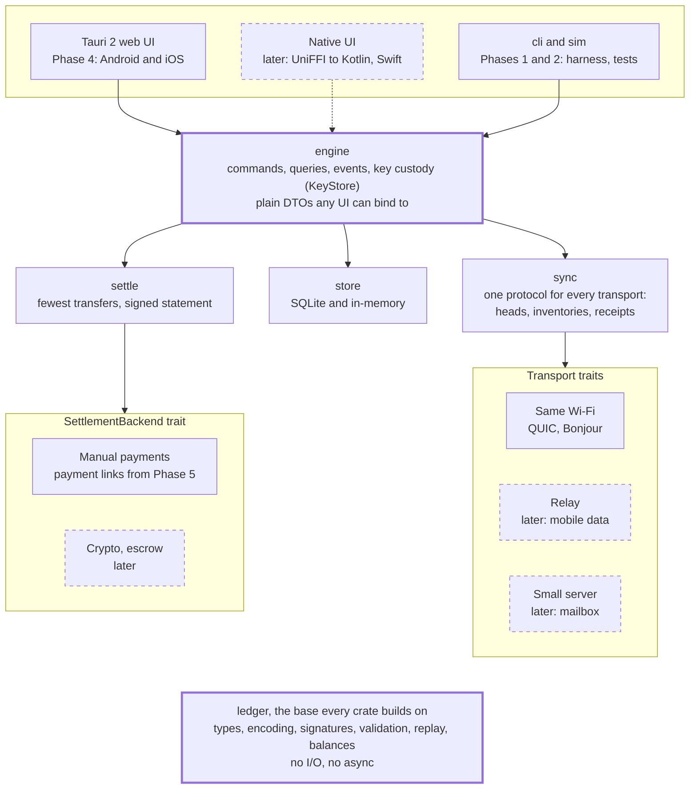

# Architecture overview

The code is one Cargo workspace in layers: a pure ledger at the bottom, settlement, storage and sync around it, one `engine` that every UI talks to, and thin shells on top. Each arrow in the stack points down only, and every box marked as a trait is where a future relay, native UI or crypto backend plugs in.

*Crate layers and extension seams. Arrows point to what each layer calls; dashed boxes are possible later additions, not decided.*

The UI shells call only the engine; a relay, small server or crypto settlement, if ever built, would arrive as new implementations of traits that already exist.

| Crate | Phase | Responsibility | Depends on | Extension seam |
| --- | --- | --- | --- | --- |
| `ledger` | 1 Core | Types, canonical encoding, hashing, signatures, record catalogue, validation, replay into party state, balances; built as an ordering layer that feeds a state layer | none (no I/O, no async) | `PublicKey` and `Signature` are algorithm-tagged enums |
| `settle` | 1 Core | Fewest-transfers solver, settlement statement, payment request builders | ledger | `SettlementBackend` trait |
| `store` | 1 Core | Persistence of objects, indexes and cached state; in-memory and SQLite implementations | ledger | `Store` trait |
| `engine` | 1 Core, sync wiring in 2 | The app's high-level workflows behind one API: commands, queries, event stream, key custody, preset files, wiring of store, settlement and later sync | ledger, settle, store (sync from Phase 2) | `KeyStore` trait; UI-neutral DTOs |
| `cli` | 1 Core | Headless harness: one process holding several identities that pass objects to each other in memory; scripted parties | engine | none |
| `sync` | 2 Sync | Sync protocol messages and session state machine, head gossip, receipts, invite links, in-memory transport | ledger | `Transport`, `Connection`, `Discovery` traits |
| `sim` | 2 Sync | Deterministic multi-phone simulation with fault injection | engine, sync | none |
| `net-lan` | 3 Local network | Same-Wi-Fi transport and desktop mDNS discovery | sync | one `Transport` implementation |
| `apps/betty` | 4 App | Tauri 2 shell, mobile plugins, web UI | engine | Tauri commands wrap the engine API |

**Why one engine.** The UI never touches ledger types directly. Every UI talks to `engine` through plain commands, queries and a stream of events, so any UI shell can bind to the same API. The preferred shape of that API is in [guidance/architecture.md](../guidance/architecture.md).

## Decisions

### No browser joiners and no wasm32 target

Accepted 2 November 2026.

Joining from a browser is dropped, even as a parked idea. That removes the reserved `Browser` member kind and the requirement that `ledger` builds and runs its golden vectors on wasm32, which existed only so a browser join page could run the same validation and replay as the phones. The targets are now Android, iOS and desktop.

**Alternative considered.** Keeping the idea parked, with `ledger` still building for wasm32 so it stayed cheap to add.

**Consequences.** `ledger` stays pure, because deterministic replay depends on that. `JoinRequest` loses its member kind field, because a request can now only come from an `App` member; `Managed` members come through `AddManaged`. A new kind that joins by request would need the field back in a new format version. No golden vector changes, because neither the `Browser` variant nor `JoinRequest` was implemented.

### The top crate is called `engine`

Accepted 2 November 2026.

The crate every UI talks to is `engine`. It runs the app's high-level workflows behind one API and calls `ledger` for anything that decides validity, so it holds no consensus rule. It was called `node`, but in ledger systems a node usually means a participant that holds and validates the log, which blurred it with `ledger`.

**Alternatives considered.** `node`, the earlier name. `device` says where the crate runs rather than what it does. `backend` suggests a server and clashes with the `SettlementBackend` trait. `app-core` is bland, and `cli` uses the crate too. `runtime` suggests async executors, and Phase 1 has no async. `service` suggests a daemon. `core` clashes with Rust's built-in crate of that name.

The stake checks in `ledger` are called "rule checks", so "engine" means only this crate.

### `ledger` is one crate of layered modules

Accepted 2 November 2026.

`ledger` stays one crate, built from modules that import in one direction only: `primitives`, then `rules`, `activities` and `records`, with `ordering` and `state` side by side above them. Activities use rules and rules never use activities, so `rules` defines its own `StakeCtx` holding only stake data and counts. `Accepted` lives in `records`, so `state` never imports `ordering`. A test in CI enforces the direction; the module table and the test are in [guidance/architecture.md](../guidance/architecture.md).

**Alternatives considered.** Separate `primitives` and `rules` crates would make the compiler enforce the direction, where the test only scans source text. They were rejected because `StakeCtx` and the checks would have to be public, so a check could run against a hand-built context; only `ledger` would use `rules`; the encoding, `Rule`, the record catalogue and the golden vectors would span three crates; and Rust's coherence rules would stop `ledger` adding inherent methods to `Rule` or `RuleSet`. The narrow `StakeCtx` removes the cycle either way.

**Consequences.** The split stays possible, because the crate boundaries would follow the same layers and bytes don't depend on which crate a type lives in. It is worth revisiting if something other than `ledger` needs `rules`, or if the test proves too weak.

### AGPL-3.0-only licence

Accepted 26 October 2026.

Betty is licensed under AGPL-3.0 (`AGPL-3.0-only`). The repository is `silvestrst/betty` on a personal GitHub account; an organisation account was the alternative.

What AGPL-3.0 means for Betty:

- **Dependencies.** Every dependency must be AGPL-compatible. MIT, Apache 2.0, BSD and MPL 2.0 all are, which covers Tauri, iroh, Borsh, BLAKE3, ed25519-dalek and UniFFI. A GPL-2.0-only crate is not. From M0, CI runs `cargo deny` with a licence allowlist.
- **App Store.** The Free Software Foundation's view is that Apple's App Store terms add restrictions the GPL family forbids, which is why some GPL apps were removed in the past. That binds people who redistribute someone else's code, not the copyright holder, so you can publish your own builds. To keep that true once other people contribute, contributions need a contributor licence agreement (or a licence grant to you) that allows App Store distribution. Google Play has no such conflict.
- **Network use.** If a relay or small server is ever built, anyone who runs a modified copy for other people must offer those people its source.
