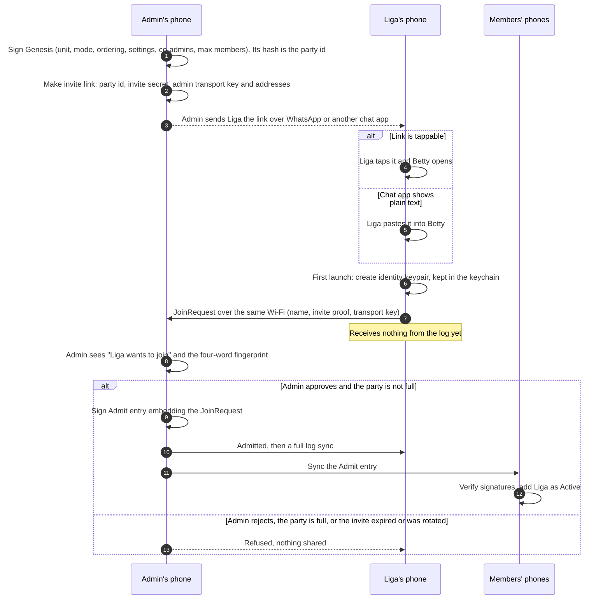

# Identity, keys and party model

A person is their device's signing key, a party is the hash of its Genesis record, and everything else hangs off those two ids.

**Keys per device**

| Key | Algorithm | Lifetime | Used for | Stored in |
| --- | --- | --- | --- | --- |
| Identity key | Ed25519 | Per device, long-lived | Signing member actions, entries, attestations, marks | iOS Keychain or Android Keystore-wrapped secret, via `KeyStore` |
| Transport key | Ed25519 (QUIC TLS identity) | Fresh per party | Authenticating sync connections | Same store, deleted when the party is archived |

Public keys and signatures are tagged enums (`PublicKey::Ed25519([u8; 32])`), so a P-256 hardware-backed key or a secp256k1 wallet key can be added as a new variant without changing the wire format of existing ones. The transport key is separate from the identity key from day one, so adding a relay later changes nothing about identity. A person is shown as their display name plus a fingerprint of four words derived from the identity key.

**Party**

- `PartyId` = BLAKE3 hash of the signed Genesis entry. Every object carries it, so objects can never be replayed into another party.
- **Unit.** Genesis names one unit: a code (`EUR`), its minor digits (2), and an optional display label. All balances are integer minor units. Chips are per activity, with an integer fraction `chip_value = num / den` units per chip.
- **Mode.** Fixed at Genesis. `AdminMajority` is the only value until Phase 5 appends `Unanimous { round_timeout_ms: u64, max_revisions: u8 }` ("Everyone agrees") as variant 1, in a new format version. The timeout and revision limit belong to the mode, so `SetSettings` can't change them. See "Decisions" in [phases.md](phases.md).
- **Ordering.** `LogOrdering::AdminChain`, the only value so far: the admin chain decides which records are accepted and in what order. It is a separate axis from the mode. The mode says who must agree before something takes effect; the ordering says who puts records in order. Genesis records both, and a phone that meets an ordering it doesn't know shows "update Betty".
- **Settings** with defaults: quorum rule majority, dispute window 48 h, takeover suggestion after 10 min of admin silence, isolate absent players on, per-party max buy-in optional.
- **Roles.** One acting admin per epoch, an ordered co-admin list (the successors offered for takeover), members.
- **Format version.** Genesis carries `format: u16` as its first field, so a phone can read it even when it can't decode the rest. A phone that meets a party with a newer format, or an entry kind it doesn't know, shows "update Betty to open this party" and never guesses.
- **Size limit.** Genesis carries `max_members: u16`, 16 for now and fixed for the party. Everyone ever admitted counts toward it, including the admin and members who left or were departed, because their balances still settle. The app writes its own `MAX_MEMBERS` constant into each new Genesis, so raising the cap later means changing that one constant: existing parties keep their limit, and a phone whose constant is lower than a party's `max_members` shows "update Betty to open this party", because every phone must run the same settlement solver for that party size.

**Members**

| Field | Values |
| --- | --- |
| `key` | identity public key |
| `kind` | `App`, `Managed` (no phone, every action entered by the admin and flagged) |
| `state` | `Active`, `Left`, `Departed` (computed from the log, never stored separately) |
| `profile` | display name, avatar colour, payout methods (Revolut handle, PayPal.me, crypto addresses by chain; in the format from M1, set from Phase 5, see "Decisions" in [phases.md](phases.md)) |
| `last_seen` | local hint only, from sync sessions; never part of the log |

**Joining, step by step.** The joiner sees nothing from the log until the admin signs an `Admit`, and a full party refuses new requests.

## Decisions

### Ed25519 for signatures

Accepted 26 October 2026.

Ed25519, with the seed protected by the iOS Keychain or Android Keystore.

**Why Ed25519.** Signing is deterministic (RFC 8032), so the ledger needs no randomness and the same input always gives the same bytes, which golden vectors rely on. Strict verification makes signatures non-malleable, so an object can't be given a second id ([ledger-format.md](ledger-format.md), "Hashing"). ECDSA on P-256 needs extra rules for that, and hardware ECDSA signs with random nonces. Keys and signatures are small and fixed-size (32 and 64 bytes), and `ed25519-dalek` is pure Rust with a permissive licence, so every target computes the same bytes. The transport key uses the same curve.

**Consequences.** Neither the Secure Enclave nor StrongBox can hold an Ed25519 key, so on most phones the seed is protected at rest and is in app memory while it signs. This is the usual model for apps built on Curve25519, such as Signal and software wallets. Android 13 and later can keep an Ed25519 key in the TEE; it would still be a `PublicKey::Ed25519` and fit the `KeyStore` trait unchanged.

**Alternative considered.** P-256 with Secure Enclave and StrongBox (hardware-backed, more platform code). Can be added later as a new key variant.

### At most 16 members per party

Accepted 26 October 2026.

At most 16 members, recorded in Genesis as `max_members` so the cap can be raised later; exact fewest transfers.

**Alternative considered.** A higher cap later, by changing one constant (see "Size limit" under "Party" above).
