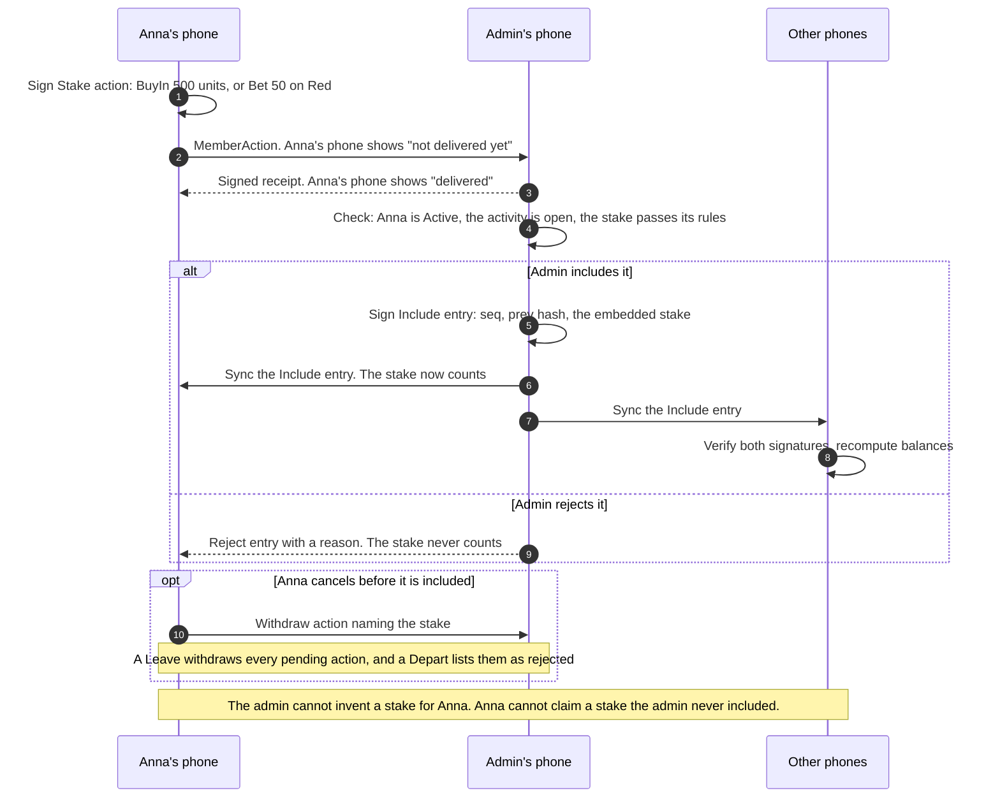

# Ledger format

The log is four kinds of signed object: admin **entries** form the one ordered chain, member **actions** are signed by their owner and embedded in an entry when included, **attestations** are detached Accept or Dispute notes, and **marks** record payments after settlement. Only entries have an order; the other three are content-addressed and can arrive in any order.

```rust
struct Signed<T> { body: T, signer: PublicKey, sig: Signature }

struct Entry {             // admin chain, one writer per epoch
    party: PartyId,
    epoch: u32,            // 0 = creator, +1 per handover or takeover
    seq: u64,              // strictly +1 across the whole chain, never resets
    prev: Hash,            // id of the previous entry (zero for Genesis)
    at: Timestamp,         // admin clock, ms since epoch, >= prev.at
    body: EntryBody,       // see the catalogue
}

struct MemberAction {      // signed by the member it concerns
    party: PartyId,
    nonce: u64,            // per signer, makes ids unique
    at: Timestamp,
    body: MemberActionBody,
}

struct Attest {            // detached, never blocks
    party: PartyId,
    target: Hash,          // entry or member action id; versions are separate entries
    verdict: Verdict,      // Accept | Dispute { line, suggestion, note } | Witness | TakeoverVote
    holds_head: Option<Head>,    // required when attesting a checkpoint or settlement
}

struct Mark {              // after settlement, detached
    party: PartyId,
    transfer: Hash,
    status: Sent | Received | Waived,
    evidence: Option<String>, // e.g. payment reference, tx hash later
}
```

**What each object is for.**

- **`Signed<T>`** wraps every object: the body, the signer's full public key and an Ed25519 signature. An object's id is the hash of the whole envelope (see Hashing and Signing below). Other objects refer to it by that id, so changing one byte changes the id. The signer is never shortened to a member index (see "Indices for public keys on ledger considered" in "Decisions").
- **`Entry`** is one link in the admin's chain, the only ordered history.
  - `epoch` is the admin's term: 0 for the creator, and each `Handover` or `Takeover` starts the next epoch with a new key. An entry counts only if the holder of its epoch signed it.
  - `seq` is its position, +1 every time and never reset. Two different entries with the same `seq` in one epoch prove a rewrite (see Equivocation).
  - `prev` is the previous entry's id, which makes the entries a hash chain: altering an old entry breaks every later one.
  - `at` is the admin's clock, used for display and timeouts; it never goes backwards.
  - `body` is what happened, from the entry catalogue: `OpenActivity`, `Include`, `Result`, `Depart`, `Checkpoint`, `Settlement` and so on.
- **`MemberAction`** is something a member does or asks for, signed by that member: a `Stake`, `ChipReport`, `CashOut`, `Leave` or another kind from the member action catalogue. It counts only once the admin embeds it in an `Include` entry, so a stake carries two signatures: the player's "I want this" and the admin's "it's in". The admin cannot invent a stake for someone, because they cannot forge that member's signature. `nonce` keeps two identical actions, such as two rebuys of 20, distinct.
- **`Attest`** is a member's note about an existing entry or member action, pointing at it by `target` id. `Accept` or `Dispute` agrees with it or flags it and never blocks anything; `Witness` confirms a proxy chip count; `TakeoverVote` supports a co-admin's takeover. A corrected result is a new entry, so an Accept always refers to one exact version. `holds_head` names the latest entry the signer holds; it is required on a checkpoint or settlement, so nobody can sign off history they have not seen.
- **`Mark`** tracks one transfer from the final settlement: the payer marks it `Sent`, the payee `Received` or `Waived`. `evidence` is an optional reference such as a payment reference, or a transaction hash if crypto settlement is ever added. Marks are detached because payments happen after the party, in any order.
- Every object carries `party`, so it can never be replayed into another party.

**A stake, step by step.** The receipt shows the action arrived; only the `Include` entry makes it count.



**The same objects in both modes.** Both modes use these four objects and nothing else; they differ only in which entry kinds they use, and so in which entries need the members' Accepts before replay applies them.

- **Admin + majority:** a `Result`, `RoundResult` or `AmendRules` takes effect when the admin signs it. Attestations are optional: an Accept is a personal sign-off, and a Dispute flags the entry for a `Correction`.
- **Everyone agrees (Phase 5),** for a chip count:
  1. The admin writes a `CountRequest` entry.
  2. Each player signs a `ChipReport` action with their own count, and the admin includes it.
  3. Once the counts add up to the chips in play, the admin writes a `ProposeRound` entry.
  4. Every Active member signs an `Accept` attestation targeting that exact version, or a `Dispute`, which leads to a new version that supersedes it.
  5. The admin writes a `Close` entry that embeds the Accepts, or records a majority close after the timeout or two revisions. Replay applies the round only once that `Close` is in the chain.
- Rule changes (`Set`, `Remove`) in Everyone agrees follow the same path, with `ProposeRules` in place of `ProposeRound`.

**Encoding.** Every object is encoded with Borsh (the `borsh` crate), whose spec gives each value exactly one encoding, under strict rules:

- Structs only; no floats, no `usize` and no `HashMap` (ordered `BTreeMap` or sorted `Vec` only).
- Integers are fixed-width little-endian, a `bool` must be 0 or 1, strings are length-prefixed UTF-8 checked on decode, and fixed arrays such as `[u8; 64]` signatures are written as they are.
- Each enum writes its variant number as one byte. Every ledger enum gives its variants explicit numbers, with `#[repr(u8)]` and `#[borsh(use_discriminant = true)]`; the derive supports this for unit, tuple and struct variants alike, checked in M0. Numbers are only appended and never reused, and gaps are allowed: decoding a number with no variant fails.
- A map or set is a `u32` count, then its entries in strictly ascending key order. Decoding enforces this through borsh's `de_strict_order` feature, which every build must enable. Without it borsh sorts out-of-order keys and keeps only the last of repeated ones without an error, so two different byte strings, with two different ids, would decode to the same value.
- A one-byte object-type tag goes in front of every object (see "Object types" below).
- Ledger types derive Borsh for the log, and serde only for presets. The UI receives `engine`'s DTOs, never ledger types. Internal types such as `Accepted` and the state replay builds are never encoded.

Golden test vectors (bytes, hash, signature) are checked into the repo and run on Android, iOS and desktop in CI, so a serializer change that alters bytes fails the build. For now CI runs them on the host only (see "Decisions" in [phases.md](phases.md)).

**Adding a field later.** Borsh writes no field labels, so a record's layout can't change once it is in use. A new field means a new kind with the next free number, in a new format version, used only by parties of that format. The old kind keeps its layout and golden vectors, and later builds still read it, so old parties replay unchanged. This holds for beta parties too, and 1.0 keeps reading them (see "Decisions" in [phases.md](phases.md)).

**Why Borsh.** It was chosen over postcard, Protobuf, deterministic CBOR and others; "Decisions" below has the reasoning.

**Hashing.** `id = BLAKE3(BLAKE3("betty/v1/<type>") || encoded Signed<T>)`. The id covers the signature, and `ed25519-dalek` verifies in strict mode, so a signature cannot be altered to produce a second id for the same content.

**Signing.** The signature covers `BLAKE3("betty/v1/<type>") || encoded body || signer`. The domain prefix stops a signature made for one object type from being valid as another.

**Object types.** Each kind of signed object has a one-byte tag and a domain string, the `"betty/v1/<type>"` above. The tag goes in front of the object wherever it is stored or synced, and only frames it: the id and the signature use the domain string, not the tag. Both are append-only like enum variants, and no two kinds may share a domain string. The string's BLAKE3 hash, the domain hash, goes in front of the signed and hashed bytes instead of the string itself. It is always 32 bytes, so the bytes after it can never be read as part of it, and one domain string may be a prefix of another. The domain hashes are precomputed constants in the code, consistent with BIP-340's tagged hashes, and a test checks each one against its string (see "Hashed domain strings" in "Decisions").

| Tag | Object | Domain string |
| --- | --- | --- |
| 0 | `Entry` | `betty/v1/entry` |
| 1 | `MemberAction` | `betty/v1/member_action` |
| 2 | `Attest` | `betty/v1/attest` |
| 3 | `Mark` | `betty/v1/mark` |

**Ordering and authority.** The chain is a single list ordered by `seq`. An entry is valid only if its signer holds its epoch: the Genesis creator for epoch 0, the `Handover.to` key, or a `Takeover` candidate whose quorum was reached. A higher epoch with a valid handover or takeover replaces the lower epoch from its base onward.

**Equivocation.** Two valid entries with the same `seq` and different ids, from the same epoch, are proof of a rewrite. Every phone stores both as evidence, gossips them, shows a red banner, and stops applying that epoch past the fork. The only way forward is a takeover by a co-admin into the next epoch, based on the last common entry. This reuses the takeover machinery, so no new rule is needed.

**Heads.** A head says how far a phone's copy of the history goes. In the current design it is `Head::AdminChain { epoch, seq, id }`, signed by the admin, and it is the unit of gossip. Every sync session starts by exchanging heads, and a phone that learns of a higher head than it holds shows "missing updates" until it has caught up.

**Ordering layer and state layer.** `ledger` is split in two, so that a different way of ordering records could be added later without touching rules, balances or settlement. How the code is arranged is in [guidance/ledger-format.md](../guidance/ledger-format.md).

```rust
// The ordering layer's output and the state layer's only input.
struct Accepted {
    id: Hash,                 // the record's own id: an entry, or the member action embedded in it
    author: PublicKey,        // who signed it: the member for their action, the admin for an entry
    at: Timestamp,            // ordering time, used for windows, timeouts and display
    body: AcceptedBody,       // Entry(EntryBody) or MemberAction(MemberActionBody), without chain fields
}

enum Head {                   // append-only, like Rule
    AdminChain { epoch: u32, seq: u64, id: Hash },
}

enum LogOrdering {            // recorded in Genesis, append-only
    AdminChain,
}
```

- **The ordering layer** checks signatures, epochs, `seq`, `prev`, handover, takeover and equivocation, unwraps `Include`, and emits accepted records in order. It is the only code that knows the admin chain exists.
- **The state layer** applies `Accepted` records one at a time: rule checks, tallies, results, governance and balances. It never reads `epoch`, `seq` or `prev`. Roles such as admin are party state, set by `Genesis`, `Handover` and `Assume` as they pass through.
- **Everything that says how far history goes uses `Head`:** the sync head exchange, `Attest.holds_head`, `Checkpoint` and `SettlementStatement.head`. Another ordering would add a variant rather than change those records.

## Decisions

### Borsh as the canonical encoding

Accepted 26 October 2026.

Every object is encoded with Borsh, under the rules in "Encoding" above.

It was chosen over postcard, the first candidate, with the possible future additions in mind:

- **Possible escrow.** Solana programs read Borsh natively and verify Ed25519 cheaply, so a Solana escrow could check Betty's own signed settlement statement as it is. EVM chains would use the separate EIP-712 form described in [ideas.md](../ideas.md) either way.
- **Parts not written in Rust.** A bot admin, a mailbox server, an account service or league tools might not all be Rust. Borsh has a written spec and implementations in TypeScript, Go, Python, Java and other languages; postcard is mostly Rust only.
- **One encoding per value by design.** With postcard, Betty's own rules and tests would carry that guarantee alone. With Borsh the format's spec carries it, decoding enforces it with the `de_strict_order` check, and the tests confirm it.
- **Stable enum numbers.** Through serde, postcard always numbers variants in declaration order. Borsh can use explicit numbers, which makes append-only less fragile.
- **Costs.** Records are roughly 10 to 20% larger because integers are fixed-width; most of each record is 32-byte keys and 64-byte signatures anyway. Ledger types also carry a second set of derives.
- **Also considered.** Protobuf is not canonical and silently drops unknown fields, so an old phone could ignore a field that changes meaning; it stays a good fit for any future server API. Deterministic CBOR (DAG-CBOR) is standardized but larger, with more rules to get right. bincode changed its byte format between major versions. FlatBuffers and Cap'n Proto are built for zero-copy speed, not for unique bytes.
- Leaderless mode, the relay, a native UI and public proof of history work the same with any of these.

### BLAKE3 for ids

Accepted 10 November 2026.

Ids are BLAKE3 hashes, as in "Hashing" above. Speed was not the reason, since objects are small and signature checks cost far more.

- **No variants.** There is one BLAKE3 with one output size, so there is no choice of variant or truncation to get wrong.
- **No length extension.** A hash can be used safely with a secret prefix, and its keyed mode can replace HMAC if a later protocol needs a MAC.
- **Same speed everywhere.** It needs no SHA instructions in the CPU, and the `blake3` crate picks its vector code at runtime.
- **Costs.** It is younger than SHA-2 and not a NIST standard, and fewer outside tools can recompute Betty's ids.
- **Also considered.** SHA-256 is the most widely supported hash. SHA-512/256 would reuse the SHA-512 code that Ed25519 already includes. Either would work, but a switch now needs a new format version.

### Hashed domain strings

Accepted 11 November 2026.

The BLAKE3 hash of the domain string goes in front of every signature and id, as in "Hashing" and "Signing" above, replacing the rule that no domain string may be a prefix of another.

- **The problem.** Raw domain bytes don't show where the domain ends. If `betty/v1/mark` were a prefix of a later `betty/v1/markup`, a mark whose body started with `up` would have the same bytes as a markup made of the rest of that body, so one signature and one id would fit both.
- **Why a hash.** Only a test enforced the prefix rule, and it had to cover every domain ever hashed, including later ones that are not object types. A hash is always 32 bytes, so its end is fixed whatever the domains are. This is the tagged-hash pattern of Bitcoin's BIP-340, and it adds no assumption, since ids already rely on BLAKE3.
- **Nothing is read from the wire.** The signer and the verifier each hash the domain of the type they handle, so no body byte can reach it. A changed tag only makes a phone check the object as another type, whose domain hash won't match.
- **Precomputed.** Each domain hash is a constant in the code, as with BIP-340's tagged hashes. A test checks each constant against BLAKE3 of its string, and that no two are equal.
- **Costs.** 32 more bytes per signed and hashed input, negligible next to an Ed25519 check. The signed bytes no longer start with readable text, so the golden vectors pin each domain hash next to its string. Domain strings must still be distinct.
- **Also considered.** Hashing the domain on each use costs a hash per call, and hashing it once on first use adds global state. A Borsh-encoded domain, length first, is also unambiguous, but its safety rests on a string-encoding detail the code doesn't show.

### Indices for public keys on ledger considered

Accepted 12 November 2026.

`Signed<T>` carries the signer's full public key, not a member index or a short id looked up in the member list.

An index names a seat in the member list, not a key, and who holds the seat depends on history that phones may not share. A takeover replaces the chain from its base and may admit members in another order, and an equivocating admin can number them differently on each branch, so one object would verify on some phones and look forged on others. A `Dispute` or `TakeoverVote` would then depend on numbering the admin controls. Detached objects have no place in the chain, so after a `Rekey` an index can't say which key signed. Stage 1 of [validation.md](validation.md) would need replayed state, where today it needs only the object, and Genesis, a `JoinRequest` and a `Rekey` are signed by keys that have no index yet. A short id derived from the key avoids the numbering problems but still needs state, and because people choose their own keys it must be about 16 bytes long to resist collisions. Indices would save about 31 bytes per object, in parties of at most 16 members.
