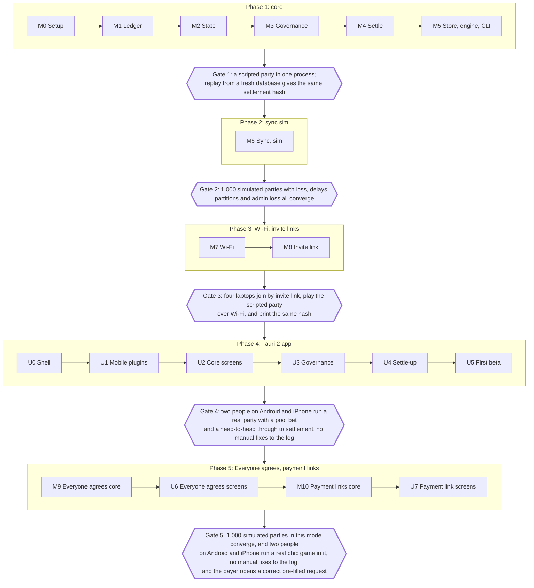

# Phases 1 to 5: core, sync, local networking, app, Everyone agrees and payment links

The work is split into five phases so each is finished and tested before the next adds a moving part: Phase 1 is the core with no networking at all, Phase 2 adds the sync protocol but tests it only in simulation, Phase 3 adds real Wi-Fi and invite links, Phase 4 is the app and first beta, and Phase 5 adds the Everyone agrees mode and payment links once all of that is finished. Phase 5 ends in a later beta, not 1.0 (see "Decisions" below).

*Roadmap: 5 phases, 19 milestones, 5 gates.*

The next phase starts only when the previous gate passes, so every rule the app later shows has been proven in the core first.

## Phase 1: core only, no networking

Crates: `ledger`, `settle`, `store`, `engine` without sync, `cli`. Nothing opens a socket; several identities live in one process and hand objects to each other in memory.

| # | Milestone | Delivers | Done when |
| --- | --- | --- | --- |
| M0 | Foundations | Workspace, licence (PolyForm Perimeter), `cargo deny` licence check, CI (fmt, clippy, tests), cross-compile jobs for Android and iOS, golden-vector harness | CI is green on all three targets with an empty ledger |
| M1 | Ledger kernel | Types, Borsh encoding rules, BLAKE3 ids, Ed25519 signing with domain separation, `Signed<T>`, heads, the ordering layer emitting accepted records, golden vectors | Vectors match byte-for-byte on all targets; decode fuzzing runs clean for 1 hour |
| M2 | Party state machine (state layer) | Genesis, admission, managed members, stakes, the four payout models with their rules and templates, the schema and limit checks presets must pass, results, void, corrections, replay into balances, rounding | Property tests: balances always sum to zero, replay is deterministic, corrections fully reverse |
| M3 | Governance | Attestations, checkpoints, quorum, Leave, Depart, proxy counts with witness, handover, takeover, Assume, Reissue, equivocation evidence | Scenario tests pass for every sequence in the diagrams except the Everyone agrees chip count (M9), including a two-person party |
| M4 | Settlement | Exact fewest-transfers solver, absent isolation, statement, dispute window, revisions, `SettlementBackend` trait, `ManualBackend` with plain requests (payee and amount), marks | Solver proven minimal against brute force for n ≤ 10 |
| M5 | Store, engine and CLI | SQLite and in-memory stores, `KeyStore` trait, `engine` commands, queries and events, preset files and the built-in set, `cli` scripted parties | A party survives a process restart; state cache rebuilds from scratch identically |

**CI runs on the host only for now,** so the "all targets" part of the M0 and M1 checks waits for the cross-compile jobs (see "Decisions" below).

**Gate 1:** one process plays a full scripted party with several identities, a dropout, a proxy count, a takeover and a settlement revision, and a replay from a fresh database gives the same settlement hash.

## Phase 2: sync protocol in simulation

Crates: `sync` with an in-memory transport, `sim`, and sync wiring in `engine`. Still no real network, so every failure is reproducible from a seed.

| # | Milestone | Delivers | Done when |
| --- | --- | --- | --- |
| M6 | Sync protocol and simulator | Session state machine, heads, inventories, receipts, in-memory transport, `sim` with drops, delays, partitions, app suspension and admin loss | Gate 2 passes |

**Gate 2:** 1,000 random simulated parties of 2 to 16 phones converge to identical state, and equivocation is always detected.

## Phase 3: local networking, Wi-Fi and invite links

Crates: `net-lan`, plus invite links in `sync`. This is where platform surprises live, so it comes after the protocol is proven.

| # | Milestone | Delivers | Done when |
| --- | --- | --- | --- |
| M7 | Same-Wi-Fi transport | Spike iroh vs quinn, chosen transport, `mdns-sd` discovery, direct-address join | Four devices on one Wi-Fi play the scripted party via `cli` |
| M8 | Invite link | `betty://` link encoding and decoding, joining from a link in the CLI | A second machine joins a party from a pasted invite link and reaches the same head over Wi-Fi |

**Gate 3:** four laptops join by invite link and play the scripted party over real Wi-Fi, including a dropout and a takeover, and all print the same settlement hash.

**Not in Phases 1 to 3:** the mobile plugins for Bonjour, NSD, keychain and invite links. They are Phase 4's first milestones, because they need the Tauri shell.

## Phase 4: Tauri 2 app and first beta

Lives in `apps/betty`: the Tauri 2 shell, the mobile plugins and the web UI, on top of `engine`. The first beta has only Admin + majority and no payment links, and this phase ends with it.

The milestones are U0 Shell, U1 Mobile plugins, U2 Core screens, U3 Governance screens, U4 Settle-up, and U5 Hardening and first beta. What each delivers and when it is done are in [app.md](app.md).

**Gate 4:** two people, one on Android and one on iPhone, run a real party with a pool bet and a head-to-head through to settlement, with no manual fixes to the log. The admin signs results, and players can dispute but not block.

## Phase 5: Everyone agrees and payment links

Starts after Gate 4, so the first beta has only Admin + majority and no payment links. Crates: `ledger`, `settle`, `engine`, `cli`, `sim`, and the app's screens in U6 and U7 ([app.md](app.md)).

| # | Milestone | Delivers | Done when |
| --- | --- | --- | --- |
| M9 | Everyone agrees core | `Mode::Unanimous` in a new format version, `ProposeRules`, `CountRequest`, `ProposeRound`, `Close`, rule changes pending until a `Close`, escape hatches, settlement closed by acceptance, `engine` commands, `cli` scripted parties, `sim` runs that include the mode | Scenario tests for the Everyone agrees sequences pass, including a two-person party; existing golden vectors still match; Admin + majority parties replay to the same settlement hash |
| M10 | Payment links core | Revolut, PayPal, BIP-21, EIP-681 and Solana Pay requests in `ManualBackend`, setting payout methods through `engine` and `cli` | Payment payloads validated against their specs; existing golden vectors still match; a scripted party replays to the same settlement hash |

**Gate 5:** 1,000 random simulated parties of 2 to 16 phones in this mode converge to identical state, an older build shows "update Betty" for such a party, and two people, one on Android and one on iPhone, run a real party in this mode with a two-player chip game through to settlement, with no manual fixes to the log. The payer opens a correct pre-filled request in a real payment or wallet app.

## Decisions

### The design targets a beta, not 1.0

Accepted 5 November 2026. Changed the same day: betas have no store listing, and Android no longer uses a Google Play testing track.

Everything in this design, through Gate 5, targets Betty's beta. Phase 4 ends in the first beta and Phase 5 ends in a later one, so passing Gate 5 doesn't make Betty 1.0. Real parties on phones are only proven with two people at that point, and mobile CI is still deferred. What 1.0 requires isn't decided yet.

The label changes what is promised to users and how Betty is distributed, not the protocol:

- **Protocol rules stay as strict.** Golden vectors, append-only enum numbers and new format versions apply to beta parties as to any other.
- **1.0 keeps reading beta-format parties,** so testers can still open their history.
- **Betas have no store listing.** On Android, Betty is a direct APK download. On iPhone, it goes out through a TestFlight public link, because every install route there still goes through Apple's signing.

**Alternatives considered.**

- Treating the end of Phase 4 or Phase 5 as 1.0, as "first release" and "v1" implied. It would promise more than two-person gates have shown.
- Letting 1.0 drop beta formats. It would simplify 1.0, but testers' parties could no longer be opened.
- Public store listings labelled beta. They are easier to install from, but reach further than this much testing supports.
- A Google Play testing track, the first choice for Android. It adds an enrollment step that a direct APK doesn't need.
- Ad hoc distribution for every iPhone. It avoids Apple's review, but each new iPhone needs its device ID registered and the build re-signed, so an unregistered phone can't join on the night, and Apple allows 100 iPhones per membership year. It stays available for Gate 4, which needs one iPhone, and as the fallback if Beta App Review refuses Betty.
- EU alternative distribution and free Xcode signing. The first works only in the EU, and the second needs a Mac and a cable for each phone.

**Consequences.**

- "v1" is no longer a release name. The docs say "the beta" for its scope and "the current design" or "Betty" elsewhere, so that nothing implies 1.0 will differ on a point nobody has decided.
- The `betty/v1/<type>` prefix in hashes and signatures stays, because it names the format, not a release. No golden vector changes.
- Reaching 1.0 commits nothing from [ideas.md](../ideas.md). The likely starting points for its criteria are what the beta skips: real parties of 4 to 8 people on phones, and the cross-compile CI jobs.
- A new player installs Betty from a link, so the invite message links to one install page that sends each phone to the right place (see [sync.md](sync.md)).
- The APK and the install page are plain downloads, hosted somewhere like GitHub Releases. The "no server" promise covers party data and sync, so it still holds.
- A direct APK has no auto-update, so the "update Betty" screen links to the install page.
- Android refuses an update signed with a different key. Without the APK signing key, testers would have to uninstall, which deletes their local copy, and a store build at 1.0 could not update them in place. The key needs safe storage from the first beta.
- Android developer verification applies to sideloaded apps in Brazil, Indonesia, Singapore and Thailand, and expands globally from 2027. U5 checks where it stands then. If it reaches testers, the options are full verification or a limited distribution account, which covers up to 20 devices.
- Publishing through TestFlight needs a paid Apple Developer Program membership, though testers don't need one, and the first external build must pass Beta App Review. A TestFlight build lasts up to 90 days, so testers need a new build at least that often.
- Store copy for a listing and the age rating wait until Betty has a public listing. The copy rules in [app.md](app.md) still apply to the TestFlight description.

### Payment links come in Phase 5

Accepted 5 November 2026.

Phases 1 to 4 and the first beta show the final balances and who pays whom, and each payer pays their own way. The `SettlementBackend` trait and `ManualBackend` stay in M4, building only plain requests with the payee and the amount. Revolut.me and PayPal.me links and BIP-21, EIP-681 and Solana Pay URIs move out of M4, U1 and U4 into Phase 5 (M10, U7). Betty can settle a party without them, because a transfer with no link already had to work.

**Alternatives considered.**

- Building them in M4 and U4, as first designed. Payers would get pre-filled requests from the first beta, but that release would also carry the payout method screens, the payload checks and testing against real payment apps.
- Leaving payout methods out of `Profile` until M10. M1 would be slightly smaller, but a record's layout can't change once it is in use (see "Adding a field later" in [ledger-format.md](ledger-format.md)). `Profile` would need a new kind in a new format version, and first-beta phones would show "update Betty" for parties they could otherwise open.

**Consequences.**

- `Profile` has its payout methods from M1, with every `PayoutMethod` variant implemented and covered by golden vectors, because a phone can't decode a variant number it doesn't know. First-beta builds have no screen to set them, so they write an empty list and ignore any methods they read.
- A first-beta payer in a party with a payee on a later build sees only the payee and the amount, even if the payee listed a method. The phones still agree, because a payment request is never part of the log.
- The statement's `backend` is `"manual"` from M4, and M10 only adds to what `ManualBackend` builds, so M10 changes neither the statement's bytes nor its hash.
- Marks stay in M4 and U4, because they were never tied to a method.
- Gate 4's real party doesn't use a real payment app. U7 and Gate 5 are the first to.

### Everyone agrees comes after the app

Accepted 4 November 2026.

Phases 1 to 4 and the first beta have only the Admin + majority mode. Everyone agrees stays part of the beta, but moves out of M3, U3 and Gate 1 into a new Phase 5 (M9, U6, Gate 5), after the core, sync and the app are finished. A party's mode is fixed at Genesis, so adding the mode later can't change how an existing party replays.

**Alternative considered.** Building both modes in M3 and U3, as first designed. It would test both from the start, but it adds acceptance flows, timers and their open questions before Betty has run a single real night. The cost of waiting is that Gates 1 to 4 never exercise this mode, so a problem with it could surface late, though only new parties could be affected.

**Consequences.**

- `Mode` in Genesis has only `AdminMajority` (variant 0) until M9. Variant 1 is reserved for `Unanimous { round_timeout_ms, max_revisions }`, so the timeout and revision limit leave the general settings. Their values stay open until M9 and are then fixed at Genesis.
- `ProposeRules`, `CountRequest`, `ProposeRound` and `Close` keep their catalogue numbers and stay unimplemented until M9.
- In Everyone agrees, a round or rule change is a proposal first, so `ProposeRound` and `ProposeRules` hold the revision fields. `RoundResult` and `AmendRules` always apply when signed and carry none. A party's mode never changes, so a `RoundResult` and a `ProposeRound` never appear in the same party. Reserving the fields on `RoundResult` and `AmendRules` from M1 was rejected: it would leave fields unused until M9, plus a rule refusing any other values.
- `format` is the first field of Genesis, so a phone can read it even when it can't decode the rest, and shows "update Betty" for a mode it doesn't know. Builds keep writing the earlier format number for Admin + majority parties, so older phones can still join them.
- Gate 4's real party runs with the admin signing results, and players can dispute but not block. The README and TestFlight description present home games that way, and this mode gets its own real party in Gate 5.

### Gates 4 and 5 are two-person parties

Accepted 4 November 2026.

Four to eight real phones may not be available, so Gates 4 and 5 and U5 no longer ask for a poker night of 4 to 8 people. Both gates use two people, one on Android and one on iPhone, and run through to settlement. Gate 4 uses a pool bet and a head-to-head. Gate 5 uses a two-player chip game, because the admin enters bet outcomes in both modes, so a bet never reaches the count, the proposed round or its `Close`.

**Alternative considered.** Keeping the poker nights. They are the closest test of what Betty is for, but the first beta and Phase 5 would wait until enough phones and people could be brought together.

**Consequences.**

- No gate runs a real party of more than two people on phones. A settle-up with more than one transfer, a dropout, a proxy count and a takeover rest on M3's scenario tests, Gate 2's simulation and Gate 3's laptops.
- Before the first beta, no real party on phones covers chip counts, which rest on the same tests.
- Gate 5 can't exercise a majority close, because a two-person party can't reach one (see question 12 in [open-decisions.md](open-decisions.md)). It rests on M9's scenario tests and the simulated parties.
- U2's four phones, the U3 and U6 sequences and the device matrix in [testing.md](testing.md) still need more than two phones. This decision doesn't change them.

### Host-only CI for now

Accepted 26 October 2026, while planning M0 and M1. Recorded on 1 November 2026.

The design asks for CI on Android, iOS and desktop from the start: the M0 and M1 acceptance checks both say all targets, and the golden vectors are meant to run on all three.

CI runs on the host only (`ubuntu-latest`) for now. The Android and iOS cross-compile jobs are added later. No milestone is set for them yet.

- M0's "CI is green on all three targets" and M1's "vectors match byte-for-byte on all targets" are checked on the host only until those jobs exist.
- CI won't catch a change that breaks a mobile build or gives different bytes on another target. `ledger` must still stay pure. The vectors are embedded with `include_str!`, so the same tests can later run unchanged on the other targets.
- The requirement stands, and this decision only defers it. Adding the jobs replaces this entry.
