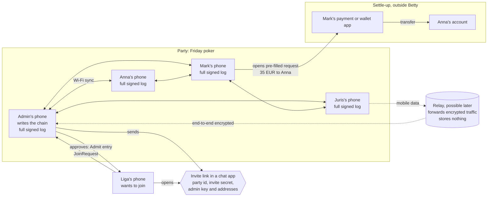

# Design principles and constraints

Every later section applies these eight rules; where a choice was close, the rule decided it.

1. **Phones are the system.** Each phone holds the full log of every party it belongs to and computes all balances itself. Reads never need the network.
2. **Only the acting admin waits on nobody.** Nothing that moves the party forward waits for anyone but the admin of the current epoch. Other signatures are either consent to a person's own money or non-blocking attestations (might change in phase 5 and further).
3. **Append only.** Records are never edited or deleted. Corrections reverse, revisions supersede.
4. **Deterministic replay.** State is a pure function of the verified objects a phone holds. The same objects give the same bytes, hashes and balances on Android, iOS and desktop.
5. **Integer units only.** Balances are signed 64-bit integers in the party's unit. No floats anywhere in the core; ratios are integer fractions and every rounding rule is written down.
6. **The core knows nothing about the UI or the network.** The ledger crate does no I/O and has no async. Transport, discovery, storage, key custody and settlement are traits, so a relay, a native UI or a crypto backend plugs in without touching the ledger.
7. **The app never holds money.** Settlement produces a signed statement and payment requests the payer completes in their own app.
8. **Fail visible, never silent.** Missing updates, undelivered member actions, admin rulings, majority closes and equivocation all show on every phone.

**Platform constraints that shape the design**

- iOS suspends backgrounded apps, so sync runs while the app is in the foreground and catches up whenever two phones meet. No phone is a server.
- Venue and guest Wi-Fi often isolates clients from each other. A phone hotspot is the fallback.
- iOS asks for Local Network permission, and raw multicast needs a special Apple entitlement. Discovery therefore goes through Bonjour on iOS and NSD on Android (see Sync).
- A phone can't scan its own screen, so Betty uses no QR codes. Invites and payment requests travel as links, and presets as files.

**The whole picture.** Every phone keeps a full copy of the signed log, and only the admin writes the official chain. New players join from an invite link the admin sends them, and the admin approves each one. Phones sync over the same Wi-Fi. A relay for mobile data and https invite links are possible later additions. At the end each payer pays their own way or, from Phase 5, opens a pre-filled request in their own payment or wallet app, so money never passes through Betty.

The step-by-step sequence diagrams are in the files they explain. In them, solid arrows are signed records or messages, and dashed arrows are attestations (Accept, Dispute, Witness, TakeoverVote), receipts or refusals.

**In the beta**

- Parties with an admin (playing or not), co-admins, invite links with admin approval, and no-phone members managed by the admin.
- Activities as four payout models: chip count (poker cash games and other chip or points games), places (tournaments of any game), pool (pari-mutuel bets) and head-to-head. Presets give each game its name and rules.
- Both modes: Admin + majority from the first beta, and Everyone agrees with self-reported chip counts in Phase 5.
- Leave, Depart, proxy counts with a witness, planned handover, quorum takeover, equivocation detection.
- Checkpoints, settlement with the fewest transfers, a dispute window and revisions from the first beta, and pre-filled payment requests (Revolut, PayPal, crypto URIs) in Phase 5.
- Transport: same-Wi-Fi peer-to-peer, with a phone hotspot for client-isolated networks.

**Possible later additions** are parked in [ideas.md](../ideas.md). They are not decided and may never be built; this design only keeps room for them.

**Out of scope**

- Holding money and taking fees. Neither is considered at this stage.
