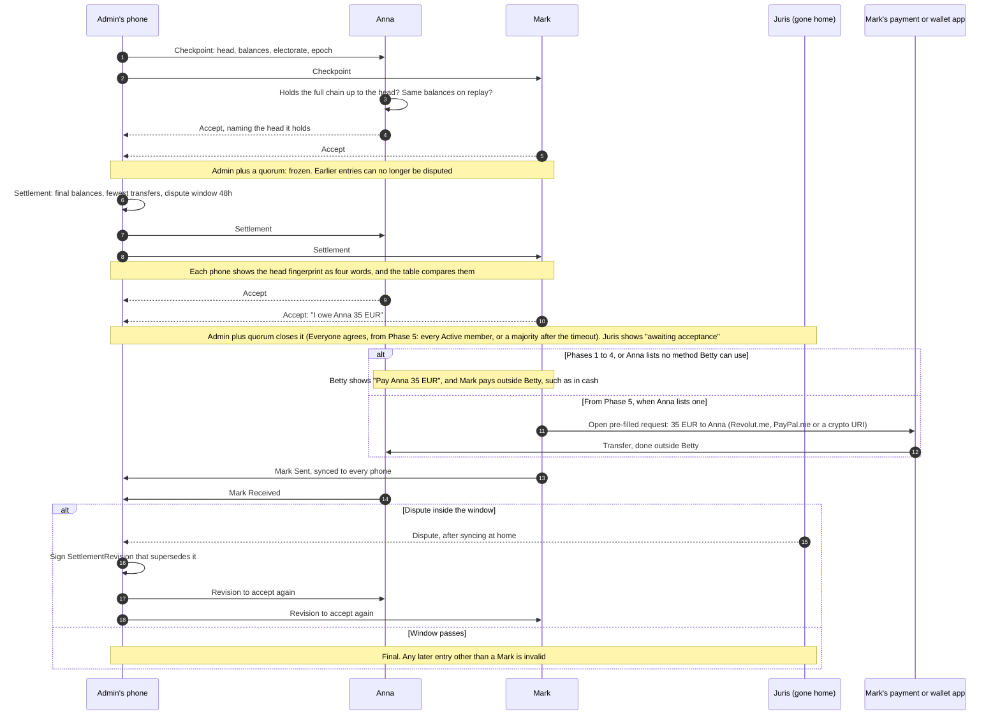

# Balances and settlement

Balances are replayed from the log in integer units and always sum to exactly zero; settlement turns them into the fewest transfers, signs them as one statement, and hands each transfer to a pluggable backend. Until Phase 5 the backend only builds plain payment requests, the payee and the amount; from Phase 5 it also builds Revolut, PayPal and crypto links.

**Balance rules per activity**

| Activity | Net per player |
| --- | --- |
| ChipCount (cash game) | cash-out chips × chip value − (buy-ins + rebuys) |
| Places (tournament) | payout share of the prize pool by finishing place, from the tier for the number of players (shares of unfilled places go to the paid places pro rata) − (buy-in + rebuys + add-ons) |
| Pool (pari-mutuel) | winners split the whole pool in proportion to their stake on the winning outcome − own stakes; nobody on the winner, or `Void`, refunds everyone |
| HeadToHead | winner + stake, loser − stake |

**Rounding.** Any division (pool shares, payout percentages, chip values) is done in integers. Remainder units go one at a time to the largest fractional parts, ties broken by ascending identity key bytes. A property test asserts that every replay sums to zero.

**Settlement solver** (`settle`)

1. Take final balances; drop zeros.
2. If "isolate absent players" is on, route each absent member's balance through one hub (the admin by default), so only one person chases them.
3. Find the fewest transfers. This is the problem of splitting the balances into the most zero-sum groups, solved exactly by dynamic programming over subsets. The party cap keeps n at 16 or below, where this runs in well under a second on a phone, and the same solver stays fast up to about 20 members. Every phone must compute the same transfers, so a solver change ships together with a higher cap, never on its own.
4. Order transfers canonically (payer key, then payee key) so every phone computes the same list and the same statement hash.

**Settlement statement.** The payload of `Settlement` and `SettlementRevision`, and the exact bytes a future escrow contract would check:

```rust
struct SettlementStatement {
    party: PartyId,
    head: Head,                       // last entry covered
    unit: Unit,
    balances: Vec<(PublicKey, i64)>,  // sorted by key, sums to 0
    transfers: Vec<Transfer>,         // canonical order
    dispute_until: Timestamp,
    backend: BackendId,               // "manual" for now
}
struct Transfer { from: PublicKey, to: PublicKey, amount: u64 }
```

The statement stays canonical and free of Betty-specific encodings in its amounts, so a later settlement backend could check it as it is.

Finality: admin-signed means in effect, quorum (or unanimous) attestation means closed, each member's own Accept binds them personally, and after `dispute_until` the party is final and any later entry other than `Mark`s is invalid.

**Pluggable backends.** Settlement hands each transfer to a `SettlementBackend`. The preferred shape of that trait is in [guidance/settlement.md](../guidance/settlement.md).

Until Phase 5, the `ManualBackend` builds a plain request for every transfer: Betty shows the final balances and, for each transfer, the payee and the amount, and tells the payer to pay their own way, such as in cash (see "Decisions" in [phases.md](phases.md)).

From Phase 5, it also builds, per payee payout method: a Revolut.me or PayPal.me link with the amount, and BIP-21, EIP-681 or Solana Pay URIs for crypto addresses. Links and URIs open the payer's own app on the same phone. If Betty can build no link for a transfer, the payer still gets the plain request. Amounts are converted from minor units using the unit's digits; a crypto request is only offered when the party unit is that asset or the group fixes a rate at settle-up (open decision).

After paying, by any route, the payer posts a `Mark { Sent }` and the payee a `Mark { Received }`, so everyone can see who still owes.

**Checkpoint, settlement and payment, step by step.** A member who went home can still dispute until the window ends.



**Fewest transfers vs. legibility.** The exact solver can create a transfer between two people who never played each other at the same table; that's expected and identical to how Splitwise works.

## Decisions

### Payment requests are links only

Accepted 3 November 2026. Replaces "SEPA payments copy details first", accepted earlier the same day.

Betty offers only payment methods that open the payer's app from a link on the same phone: Revolut.me, PayPal.me and crypto URIs. Betty therefore shows no QR codes at all.

**Alternative considered.** SEPA bank transfers, through an IBAN payout method, with copy buttons for the details and an EPC QR on the payee's phone. A phone can't scan its own screen and SEPA has no standard link, so paying takes more steps, and it only works in euros. It can come back later as a new payout method, as noted in [ideas.md](../ideas.md).

**Consequences.** A pre-filled request needs the payee to have listed a method Betty can build a request for; otherwise the transfer tells the payer to pay their own way. Betty can't know which apps the payer has, so marks aren't tied to a method, and a payment made any way at all can be marked as sent and received. No golden vector changes, because payout methods aren't implemented yet.
