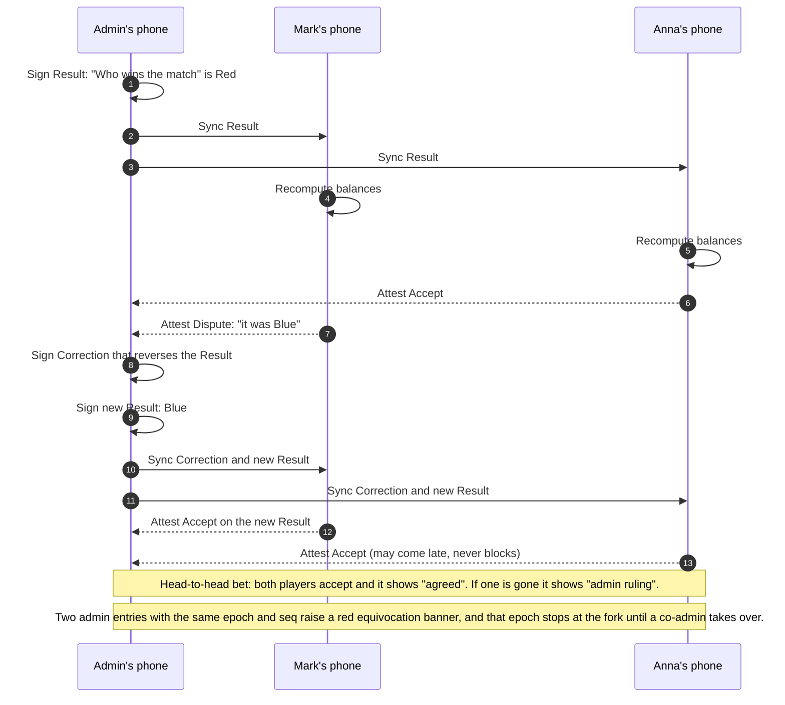
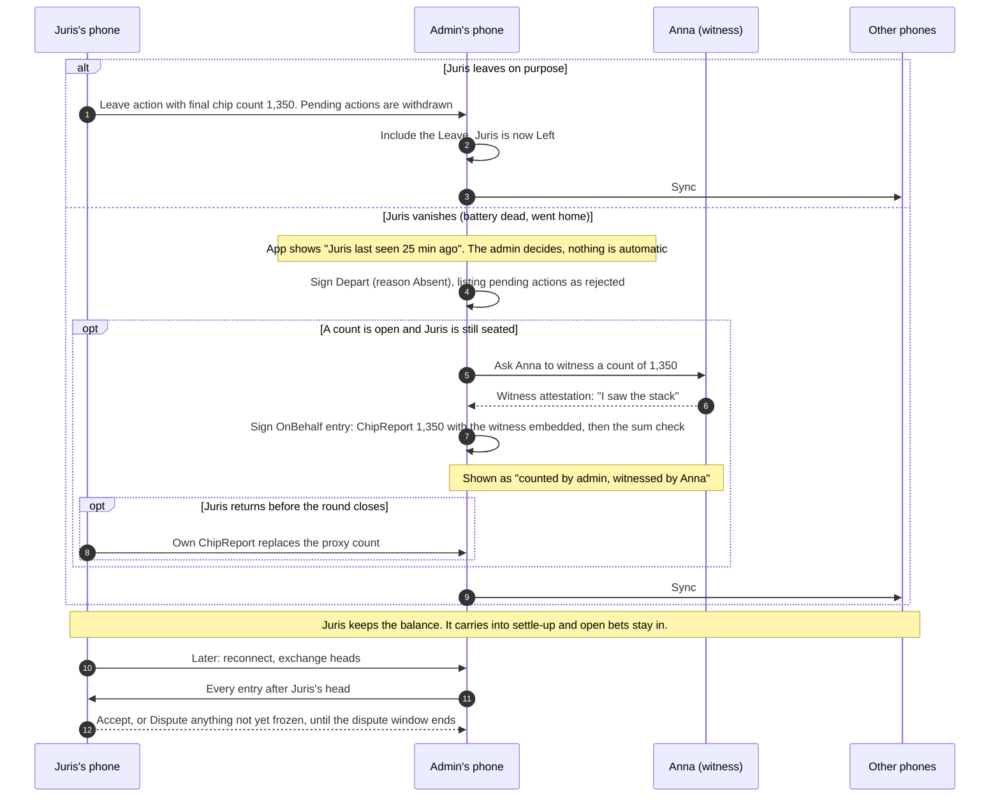
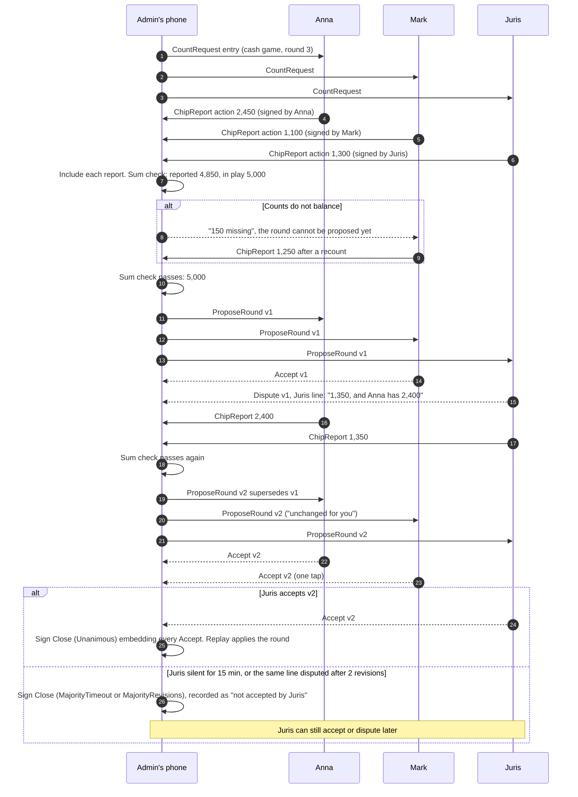
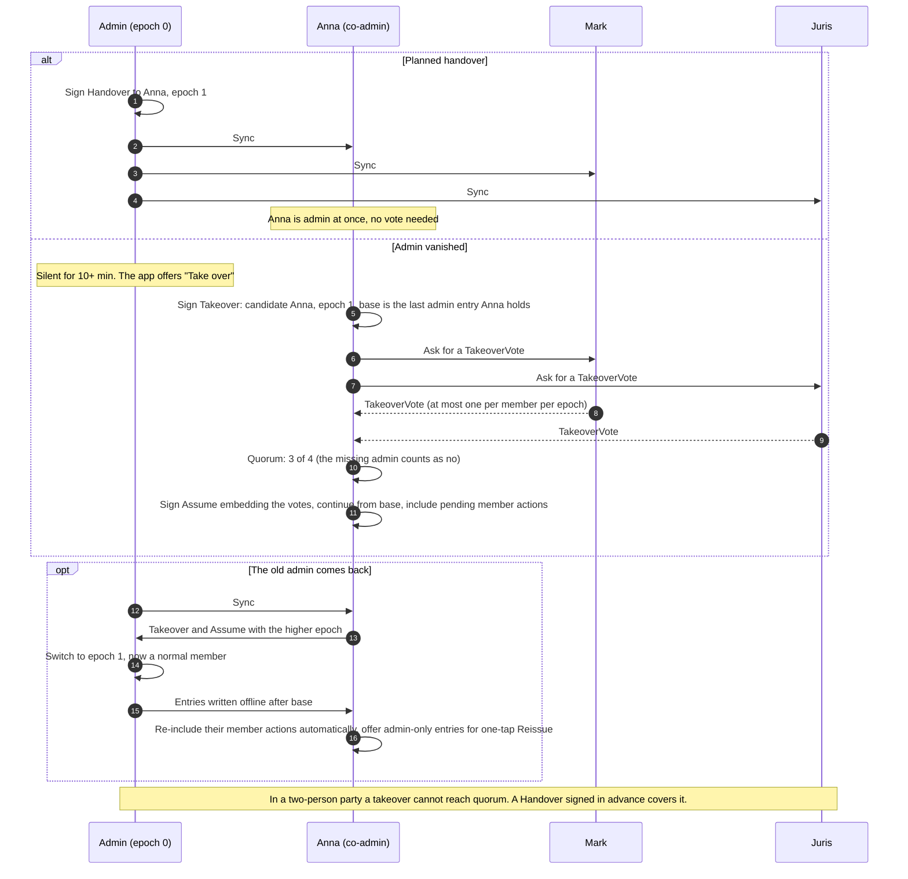

# Validation, modes, dropouts and admin handover

Every phone runs the same three-stage check on every object, and replay applies only what passes. Stages 1 and 2 belong to the ordering layer and stage 3 to the state layer (see Ledger format). Objects that fail are kept in a quarantine table for diagnostics, never applied.

1. **Decode and verify.** Known format and type, canonical bytes (re-encoding gives the same bytes), strict signature check, correct `party`.
2. **Authority.** Member actions signed by the member they concern (or, for `OnBehalf`, by the admin with an embedded witness). Entries signed by the holder of their epoch. Attestations signed by a member.
3. **State rules,** checked during replay against the state just before the entry:

**Membership and stakes**

- A stake, chip report or cash-out is valid only if its owner was Active when included, the activity is open and not locked, and the stake satisfies the activity's rules (entry count, rebuy and add-on windows and counts, amounts, per-player caps, allowed players) and the party's max buy-in.
- Pending actions of a member who leaves are withdrawn by `Leave`; those of a departed member are listed as rejected in `Depart`. A stake that was never included never counts.
- `Managed` members' actions arrive only as `OnBehalf` entries and are flagged "admin-entered" everywhere.
- An `Admit` or `AddManaged` is valid only while fewer than `max_members` people have been admitted; a `Rekey` keeps the same member. When the party is full, the admin's phone shows "Party full (16 of 16)" on a new join request instead of Admit.

**Results and corrections**

- `Result`, `Void`, `Correction`, `Depart` and all authority entries are admin-only.
- A `Correction` names the entry it reverses; replay drops that entry's effect and keeps both visible.
- A head-to-head result shows "agreed" when both players accept it, otherwise "admin ruling".
- A `Places` result lists every entrant in finishing order, including players who have left or been departed. Leaving never changes a standing by itself.
- `RoundResult` is valid only in Admin + majority. `ProposeRules`, `CountRequest`, `ProposeRound` and `Close` are valid only in Everyone agrees, where `AmendRules` holds only window changes.
- A second `RoundResult` for the same round is invalid unless a `Correction` has reversed the first, which is how a round is corrected.

**A result and its correction, step by step.** This works the same in both modes, because a bet's result takes effect when the admin signs it.

**Chip counts (both modes)**

- Sum check: the counts in a `RoundResult` or `ProposeRound`, or the cash-outs closing a chip-count activity, must equal the chips in play (buy-ins, rebuys and add-ons converted to chips). A gap blocks the round and is shown as "reported 4,850, in play 5,000".
- A proxy count (`OnBehalf` with a `ChipReport`) needs: the player seated in that activity, a `Depart` already recorded, the count still open, and one `Witness` attestation from another Active `App` member. If the player's own report arrives before the round closes, it replaces the proxy. In Admin + majority, a count stays open until the admin signs that round's `RoundResult` or the cash-outs close the activity.

**A player leaving or dropping out, step by step.** A proxy count needs a `Depart` first and one `Witness`.

**The two modes in plain words.** A party runs in one of two modes, chosen in Genesis and fixed for the party. Only Admin + majority exists until Phase 5 adds Everyone agrees (see "Decisions" in [phases.md](phases.md)).

- **Admin + majority** (`AdminMajority`) suits bigger events, a host who runs everything, and sweepstakes. It is also how home games run in the first beta.
  - The admin enters results and chip counts. A result takes effect the moment the admin signs it; nobody has to approve it first.
  - Players can Accept or Dispute any result, but that never blocks the party. A dispute flags the result for the admin, who fixes it with a `Correction`. Changes to an activity's rules also take effect as soon as the admin signs them.
  - A majority (the admin plus more than half of the Active members) is needed for only three things: freezing a checkpoint so earlier records can no longer be disputed, closing the final settlement, and letting a co-admin take over if the admin disappears.
- **Everyone agrees** (`Unanimous`, from Phase 5) suits small home games among friends.
  - After a round, the admin opens a count and each player enters their own chip count. The counts must add up to the chips in play before a result can be proposed.
  - The admin proposes the round result, and it closes only when every Active member accepts the latest version. A dispute leads to a corrected new version that everyone accepts again. Changing an activity's rules mid-game (Set or Remove) works the same way; opening and closing windows takes effect at once.
  - So it never halts: if someone is silent for 15 minutes, or the same line is still disputed after two revisions, the admin may close the round by majority. The close is recorded with who did not accept, and they can still accept or dispute later.

In both modes, only the admin writes the official log, dropouts and admin takeover follow the same rules, and bet outcomes are entered by the admin.

**Mode rules**

|  | Admin + majority | Everyone agrees (Phase 5) |
| --- | --- | --- |
| Who enters chip counts | Admin, or players via `ChipReport` | Each player via `ChipReport` after a `CountRequest` |
| Round or result takes effect | When the admin signs it | When every Active member accepts the latest `ProposeRound` version, recorded by `Close` |
| Rule change (`Set`, `Remove`) takes effect | When the admin signs `AmendRules` | When every Active member accepts the latest `ProposeRules` version, recorded by `Close` |
| Window change (`OpenWindow`, `CloseWindow`) | When the admin signs it | Same, no vote |
| Escape hatch | Not needed | `Close` by majority after the timeout (15 min) or after the same line is disputed past 2 revisions, recorded with who did not accept |
| Checkpoint frozen | Admin plus a quorum of its electorate | Same |
| Settlement closed | Admin plus quorum | Every Active member, or majority after the timeout |

**An Everyone agrees chip count, step by step (Phase 5).** The round counts only once a `Close` entry is in the chain.

**Quorum.** The electorate is the Active member list written into the latest checkpoint (or Genesis plus admissions before the first one). Quorum is more than half of it, admin included. It is used only to freeze a checkpoint, close a settlement and approve a takeover.

**Attesting what you hold.** A phone refuses to sign an Accept on a checkpoint or settlement unless it holds the full chain up to the head named in it and its own replay gives the same balances. Attestations carry that head, so a stale phone cannot be tricked into signing.

**Admin epochs**

- `Handover { to, epoch + 1 }` takes effect at once, no vote.
- `Takeover { candidate, epoch + 1, base }` is signed by the candidate. Members attest it with `TakeoverVote`, at most one per member per epoch; the phone enforces this. With a quorum of the last electorate (the missing admin counts as a no), the candidate writes `Assume` embedding the votes and continues from `base`.
- When the old admin returns, their phone switches to the higher epoch. Member actions embedded in their orphaned entries are re-included automatically; admin-only orphans are shown to the new admin for one-tap `Reissue`.
- Known limit: a two-person party cannot reach a takeover quorum, so the app offers a pre-signed `Handover` when a party has two members.

**Handover and takeover, step by step.** With four members the quorum is 3, and the missing admin counts as a no.

**Time.** Entry timestamps come from the admin's clock and must not go backwards. Timeouts are measured from the time the ordering layer gives accepted records (currently the admin entry's timestamp), never from arrival times. The settlement's `dispute_until` is checked against the entry timestamp of any `SettlementRevision`; phones additionally show a revision that arrives long after the window as "late".
