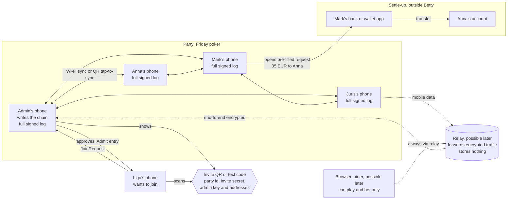
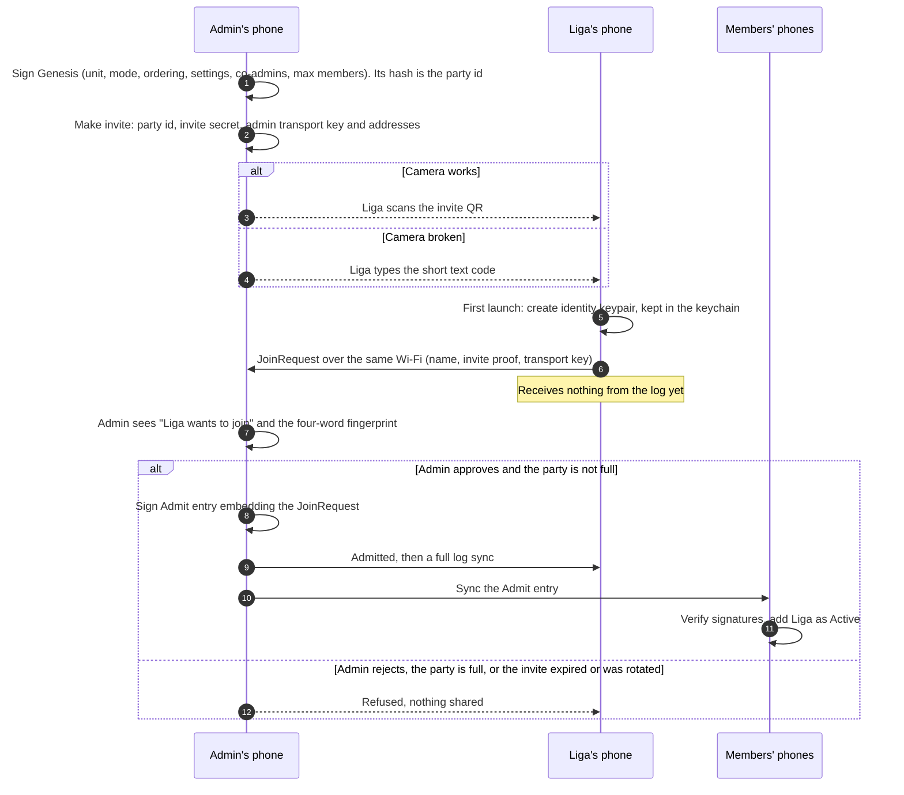
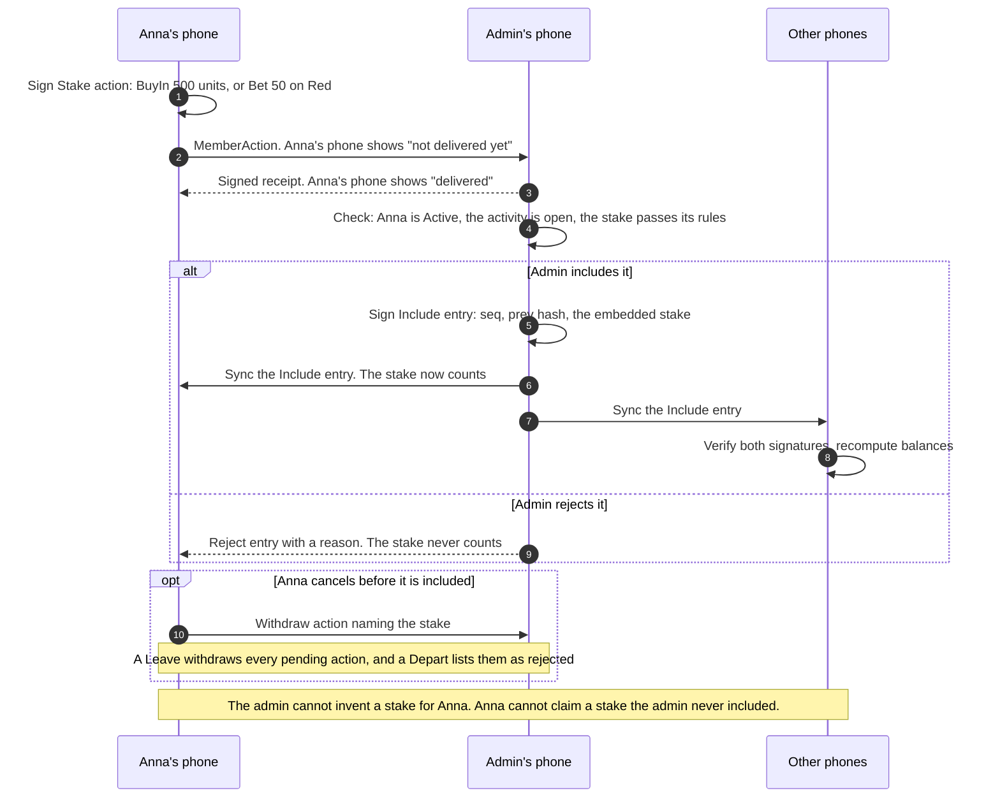
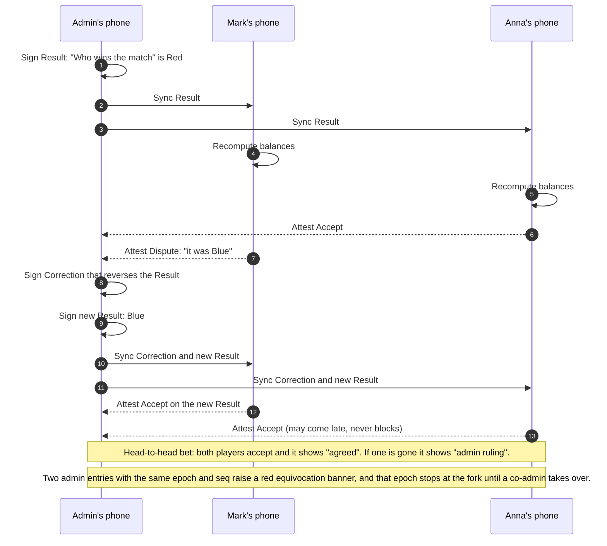
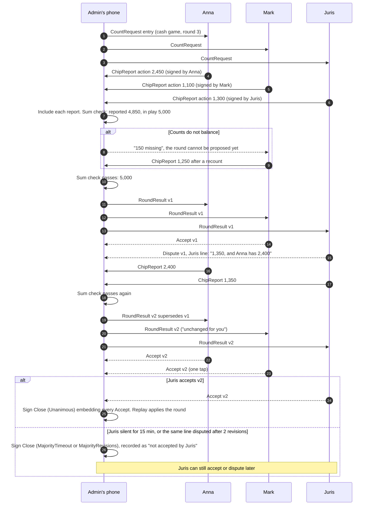
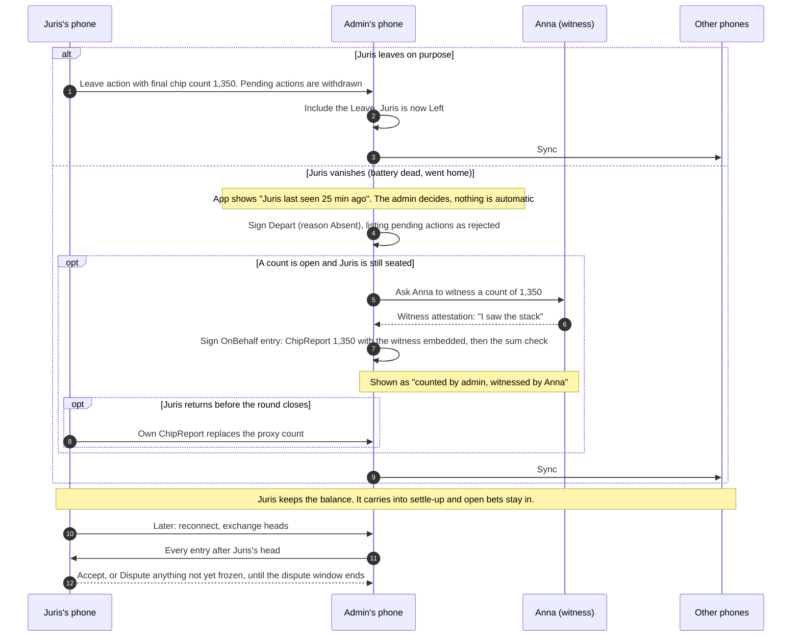
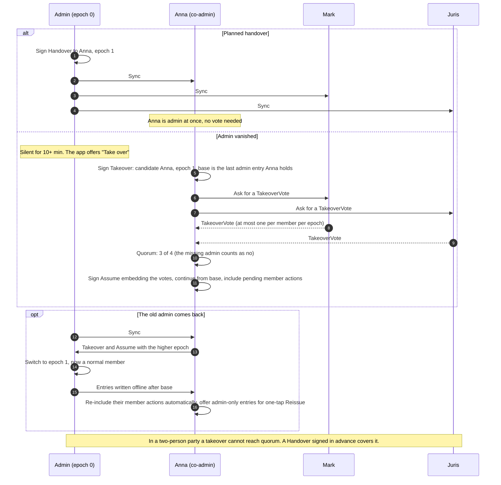
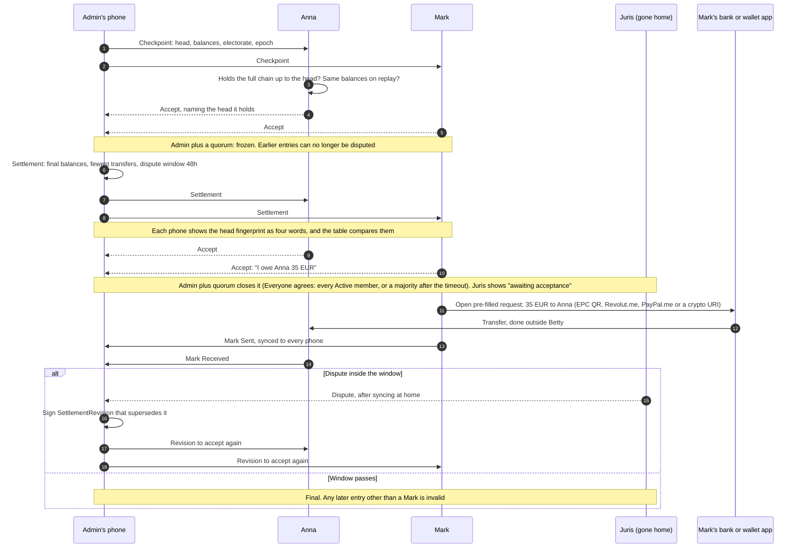
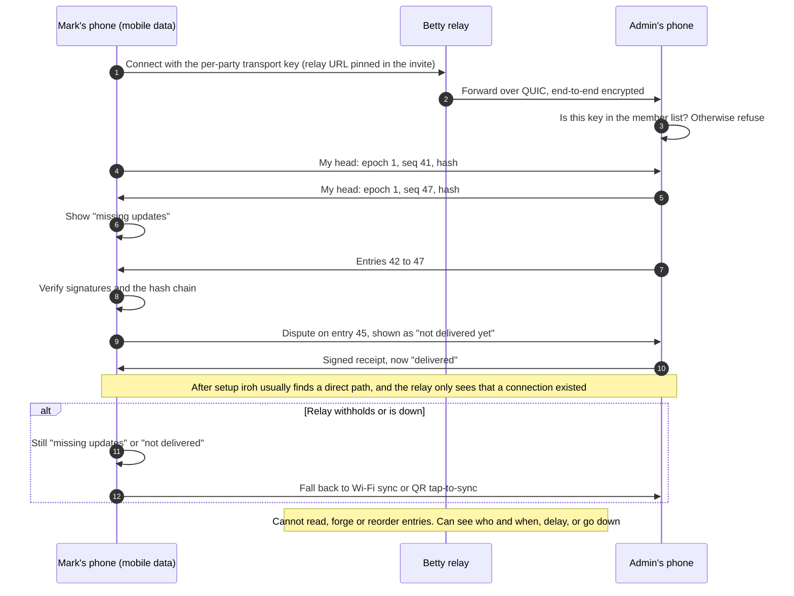

# Betty architecture diagrams

Mermaid source for the overview and each use case. They started from `assessments/party-ledger-assessment.md` (part c and Follow-ups 2 to 4) and were brought in line with the v1 technical design on 26 October 2026, which also shows the seven use-case diagrams next to the sections they explain. Solid arrows are signed records or messages, dashed arrows are attestations (Accept, Dispute, Witness, TakeoverVote), receipts or refusals.

## The whole picture

Every phone keeps a full copy of the signed log, and only the admin writes the official chain. New players join by scanning the admin's invite QR, and the admin approves each one. Phones sync over the same Wi-Fi or by QR tap-to-sync. A relay for mobile data, share-sheet links and browser joiners is a possible later addition. At the end each payer opens a pre-filled request in their own bank or wallet app, so money never passes through Betty.

## Create a party and join it

The admin signs the Genesis entry and shows an invite QR, with a short text code as the fallback. The invite only lets someone ask to join: the joiner sees nothing from the log until the admin has checked the name and key fingerprint and signed an `Admit` entry that embeds the request. A full party (16 members in v1) refuses new requests.

## Buy in or place a bet

Anything that touches a player's money carries two signatures. The player signs a `Stake` member action, and the admin embeds it in an `Include` entry with a second signature. A receipt shows it arrived; only the `Include` makes it count.

## Results and corrections

Only the admin writes results, and in both modes a bet's result takes effect when the admin signs it. Players attest with Accept or Dispute, which never blocks the party. A mistake is fixed with a `Correction` that reverses the old entry, so nothing is edited or deleted.

## Chip count in Everyone agrees mode

Each player reports their own chips, and the app checks that the counts add up to the chips in play before the admin can propose a result. The round counts only once a `Close` entry is in the chain: with every Active member's Accept on the latest version, or by majority after a timeout or a repeated dispute, so the round never halts.

## A player leaves or drops out

A player who leaves on purpose signs a `Leave` with their final chip count. A player who simply vanishes is marked Departed by the admin. If they are still seated in an open count, the admin may enter a proxy count as an `OnBehalf` entry, but only with one `Witness`, and the player can dispute it later.

## Admin handover and takeover

Only one key may write the chain at a time, numbered by epoch. A leaving admin hands over with one `Handover` entry. If the admin vanishes, a co-admin signs a `Takeover`, collects `TakeoverVote`s from a majority of the last checkpoint's electorate (the missing admin counts as a no), and starts the new epoch with an `Assume` entry.

## Checkpoint and final settlement

A checkpoint freezes everything before it once the admin and a quorum accept it. The settlement adds the fewest-transfers list and a 48-hour dispute window. Each payer then opens a pre-filled payment request in their own bank or wallet app and marks it sent.

## Sync over the relay

The relay is a possible later second transport, not part of v1. It forwards encrypted traffic and can see only metadata. Head gossip and delivery receipts make withholding visible, and same-Wi-Fi or QR sync always remain as fallbacks.

