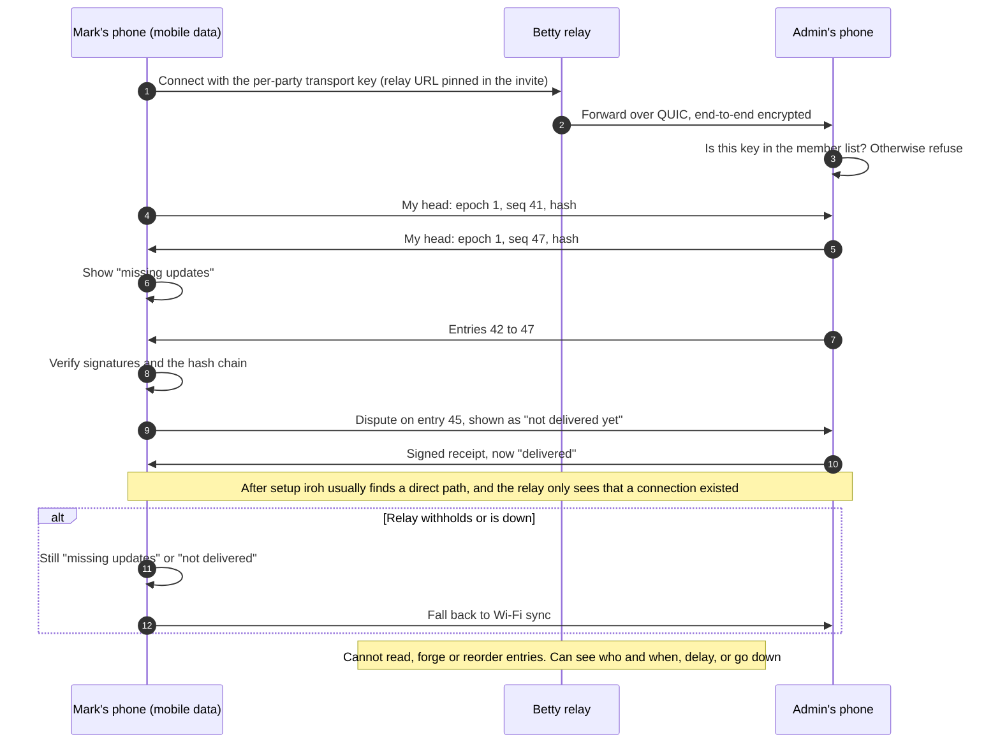

# Ideas

A parking lot for things worth remembering that nobody has committed to. Nothing is built from this file.

None of these is planned or committed, and some may never be built. The design only keeps them possible: each would attach at a seam the current design already has, without migrating existing parties; a few would add a format version that only new parties use.

The seams themselves, such as the `Transport` trait, are decisions and live in [design/](design/). To take an idea up, move what it decides into the design, as [design/README.md](design/README.md) describes.

## Possible additions

| Possible addition | Already in the design | What it would add, if built |
| --- | --- | --- |
| Relay for mobile data | `Transport` trait; per-party transport keys; head gossip, receipts and member-only sessions in the protocol | `net-relay` (iroh with Betty relay URLs pinned in the invite), relay binary in two regions, log-free |
| Small always-on server (mailbox) | Content-addressed objects | A bundle mode of the protocol and a headless `engine` that stores encrypted bundles for offline phones. Needs a party data key, added as a new entry kind (`SetPartyKey`, encrypted to each member) and a new format version |
| Native UI | All logic in `engine`; DTOs are plain records and enums | UniFFI bindings to Kotlin and Swift; the native UI uses the same commands, queries and events |
| Direct crypto settlement | Currency-agnostic integer units; `SettlementBackend` trait; canonical signed statement; crypto addresses in profiles; algorithm-tagged keys; `Mark` evidence field | `CryptoTransferBackend` that watches a chain for the payer's transfer and fills `Mark` evidence with the transaction hash |
| Escrow contract | Statement finality rule (admin + quorum + dispute window) that a contract can check | `EscrowBackend` with deposit, submit statement, dispute window and refund on timeout; a `WalletLink` member action binding identity to wallet; stakes carrying a funding reference. Gated by licensing, store policy and a contract audit, not by code |
| Member-set odds | Activity kinds are an extensible enum behind the format version; ratios are integer fractions with written rounding rules; balance rules live per activity in replay | `FixedOddsBet` activity: a named member (admin or player) offers odds as integer fractions with a liability cap, and players stake against that member. Odds come from a person, never from Betty; store copy is reviewed when this ships |
| Push notifications | `engine` event stream; head gossip tells a phone what it is missing | A `Notifier` trait and a small forwarding service on APNs and FCM that sends only a content-free "Betty event" notification; the user opens Betty and the phone syncs over any available transport, so it doesn't need the relay or mailbox. Details below |
| Accounts | Identity is a key, not a login; `Rekey` already moves a seat to a new key | Optional account layer: a `PersonId` with `DeviceLink` records signed by both keys (several devices per person), and an account service for end-to-end encrypted key backup and party history across devices. Parties keep working with plain keys |
| Other backend features | Sync protocol is transport-neutral; objects verify themselves | Https invite links with universal and app links, SMS or email verification of joiners, cloud stats across parties, encrypted backups. Each is a client of the relay or small server and never holds balances |
| Hardware-backed keys | `KeyStore::sign` hides the key; `PublicKey` enum | A P-256 variant using the Secure Enclave and StrongBox |
| Groups and stats across parties | Identity key is stable across parties | A `Group` object listing parties, and local stats computed from held parties |
| Leaderless parties | Ordering recorded in Genesis, separate from the mode; ordering and state layers that meet only at the Accepted record; the Head enum; timeouts from accepted-record time; content-addressed objects and transport-neutral sync | A leaderless ordering in a new format version, for new parties only: each member signs their own chain, every phone merges the chains in one deterministic order, and results and settlement close by acceptance instead of an admin signature. Details below |
| Bot admin | Rules are enforced in replay on every phone; handover and co-admins; the small always-on server above | A headless `engine` on the relay or small server that holds an admin key and includes every member action that passes the rules, so stakes don't wait for a busy host. Results and counts still come from a person |
| Leagues and seasons | Stable identity keys; groups and stats across parties; a format version per party | Activities that run over many evenings, likely with a sub-admin per activity. They would break the assumption that parties end within days, so a format change would have to migrate running leagues |
| Public proof of history | One `Head` names the whole history; the settlement statement is canonical and signed | Publishing a head or settlement hash to a public timestamp service or blockchain, so outsiders can check that a party's history existed unchanged at that time. No change to the chain |
| Per-person invite links | `Admit` embeds the `JoinRequest`; admin approval with a fingerprint check; a format version per party | One single-use link per person and a list of them on the admin's phone. Details below |

## One escrow detail worth fixing now

EVM contracts verify secp256k1 signatures cheaply but Ed25519 expensively. The plan for escrow is therefore that each member's linked wallet co-signs an EIP-712 typed-data form of the same `SettlementStatement`. The current design only has to keep the statement canonical and free of Betty-specific encodings in its amounts, which it does.

## A possible leaderless mode

Not planned and possibly never built; described here so the current design keeps it cheap to add.

- **When it would help:** parties nobody wants to host, groups that split up for hours and merge later (a weekend trip, several tables offline), and activities shared between two parties. For an ordinary poker night the admin chain stays simpler and better.
- **How it would work:** every member writes their own chain of signed records, with their own `seq` and `prev`. Each record also names the latest records it has seen from the others, so the records form a graph, and every phone sorts that graph into one order the same way (causal order, ties broken by id). A new ordering layer emits that order as `Accepted` records, and the state layer replays it unchanged.
- **What changes for players:** a record counts once it is in the merged order, with no admin to include it. A request that loses a race, such as two players taking the last seat, is refused on every phone after sync. Results, rule changes and the settlement close by acceptance from everyone or a majority, as in Everyone agrees, because nobody has authority alone. A record that arrives late can still move earlier in the order, so recent state is shown as provisional until a checkpoint signed by a majority freezes it.
- **How the current design already prepares for it:**
  - **Ordering is its own setting.** Genesis records `LogOrdering` next to the mode, and the current design has only `AdminChain`. A leaderless party would be a new value in a new format version; phones that don't know it show "update Betty", and existing parties are untouched.
  - **The ledger is split at one record.** The ordering layer turns the admin chain into `Accepted` records, and the state layer applies them without ever reading `epoch`, `seq` or `prev`. A leaderless ordering layer would emit the same `Accepted` records from merged member chains, so rule checks, tallies, results and balances stay as they are.
  - **Heads are an enum.** Sync, `Attest.holds_head`, `Checkpoint` and the settlement statement all use `Head`, so a `Head::Frontier` with one head per member is one new variant, not a change to those records.
  - **Time comes from the ordering layer.** Windows and timeouts use the time of accepted records, not of admin entries, so they keep working when nobody is admin.
  - **Records other than entries are neutral.** `MemberAction`, `Attest` and `Mark` are signed by their author, named by their hash and carry no chain fields, so they carry over unchanged. Only `Entry` belongs to the admin chain; a member's chain record would be a new envelope whose body reuses the `EntryBody` and `MemberActionBody` kinds.
  - **Roles are party state.** Who may enter a result is decided in the state layer from `Genesis`, `Handover` and `Assume`, so a mode without an admin changes who holds that permission, not where it is checked.
  - **Agreement already exists.** Everyone agrees closes a result with a `Close` that embeds every member's `Accept`, with the majority escape hatches, and checkpoints freeze history with a quorum. A leaderless party would use the same mechanisms for results, rule changes, the settlement and freezing provisional state.
  - **Sync is content-addressed.** Objects travel by hash with inventories and receipts, whatever their order, so transports and storage need nothing beyond the new head variant.
  - **Parties are short-lived.** A party is final 48 hours after settlement, so nothing needs migrating: old parties finish on the admin chain, and only new parties could choose leaderless.
- **What it would reuse and add:** it reuses the state layer, rule checks, payout models, balances, the settlement solver, object storage, transports and most of the UI. It adds the new ordering layer, a `LogOrdering::Leaderless` value, a `Head::Frontier` variant with one head per member, merge and conflict tests in the simulator, and screens for provisional and refused records.

## Sync over a possible relay

Not planned and possibly never built; drawn here to show how the relay row above would work. The relay would forward encrypted traffic and could see only metadata. Head gossip and delivery receipts make withholding visible, and same-Wi-Fi sync always remains as a fallback.

## Per-person invite links

Not planned. Betty keeps one shared link per party, because it is simpler: the admin sends one message and everyone can use it. The cost is that the admin can't tell who holds the link, anyone it is forwarded to can ask to join until it expires or is replaced, and the admin's approval is the only check.

- **How it would work:** each link is for one person and has its own secret. The first valid `JoinRequest` ties the link to that phone's identity key, and the admin's phone saves this before it answers. A retry from the same key counts as the same request, so a dropped connection doesn't use up the link. Any other key is refused, and the admin sees the attempt with that phone's fingerprint.
- **What the admin would see:** a list of every link, with who it is for, when it was made and its state: open, waiting for approval, joined, refused, cancelled or expired. Betty can't see whether a link was delivered or opened, only when a `JoinRequest` arrives.
- **What it would change in the records:** `JoinRequest` gains an invite id, the hash of the secret. Replay rejects a second `Admit` with the same id, so every phone enforces it. `RotateInvite` and the invite commitment in Genesis would go, because the admin can cancel one link at a time. Once these records have shipped, this needs a new format version that only new parties use.
- **What it would change on the admin's phone:** the list stays on that phone and never enters the log, so the names of people who never join stay private. Replay can't rebuild it, and it is updated in place, so it would be an exception to append-only writes. If it is lost, its open links are refused. After a handover or takeover, the old admin's unused links stop working and the new admin sends new ones.
- **Choices worth keeping:** rejecting a request ends the link instead of reopening it, because the link may have reached the wrong person. Using up a link only at `Admit` was rejected, because several phones could then queue on one link and leave the admin to pick between them. Recording each invite in the log was rejected, because it adds an entry per link and puts invited people's names on every phone.
- **Costs and limits:** inviting 15 people takes 15 shares. A link posted to a group chat lets in only the first person who uses it, so the refusal message and the pre-filled message would both have to explain that. A link is only text in a chat, so Betty can't stop someone opening it twice, only a second phone joining with it. The replay rule catches mistakes, such as a restored admin phone reusing a link, not a dishonest admin, who can make more links.

## Push notifications through a forwarding service

Not planned, and not part of the current design. Betty syncs while the app is in the foreground, because iOS suspends backgrounded apps and a suspended phone can't receive anything directly from another phone. A push notification can still reach it, but Apple and Google only accept a push request signed with the app's key, however small the message is, so something has to hold that key. Nothing here has been tested on real devices.

- **How it would work:** a phone records something and asks the service to notify the other phones in the party. The service signs the request, passes it to APNs or FCM, and stores nothing. Each phone shows "Betty event", the user opens Betty, and the phones sync as usual.
- **What it would add:** the service, a `Notifier` trait, and an exchange of push tokens between phones during sync. Tokens would stay out of the log, because they identify devices and the log is kept on every phone. The ledger and the sync of records wouldn't change.
- **What it needs from users:** notification permission on each phone, and internet access on the sending and receiving phones. On an offline hotspot, Betty behaves as it does without the service.
- **Choices worth keeping:**
  - The service stores nothing and receives the push tokens with each request, because holding a list of party members would give it data to protect.
  - Shipping the signing key inside the app was rejected, because anyone could extract it and notify every Betty user, and revoking it would break push in every installed copy.
  - CloudKit was rejected as the main route. Apple would send the notifications with no server of Betty's own, but Android phones have no clean way to write the record that triggers them, so an Android phone couldn't wake a suspended iPhone, and mixed parties are the normal case. It also requires an iCloud sign-in.
- **Costs and limits:**
  - **The "no server" promise:** the README and the design overview both promise no server, so both would need rewording. The notifications must stay optional, so Betty works fully if the service is down or a notification is lost.
  - **Metadata:** the service, Apple and Google could see when a party is active and which devices are in it, though not its bets or balances.
  - **Running it:** someone has to keep the service up and pay for it, and limit abuse without accounts.
  - **Notification overload:** one notification per bet would be annoying, so senders would have to limit how often they ask.

## Smaller notes

Asides that sat next to the decisions they relate to.

- **Configurable rule logic.** Rejected for now (see "Decisions" in [design/rules.md](design/rules.md)). If it is ever needed, it can be added as one more `Rule` variant holding a small, limited expression (for example the CEL language), with its own format version.
- **Ties and deals in `Places`.** Two players tied for second or a chopped final table are not handled in the current design; tied players sharing the payouts of the places they cover is the natural later addition.
- **A party cap above about 20.** A cap above that would add a deterministic greedy fallback for larger parties (largest debtor to largest creditor, at most n − 1 transfers). The solver would ship together with the higher cap (see "Decisions" in [design/identity-and-party.md](design/identity-and-party.md)).
- **Relay crates,** if a relay is ever built: `relay` for the binary and `net-relay` for the transport, a second `Transport` on top of `sync`.
- **SEPA bank transfers.** Dropped from the current design (see "Decisions" in [design/settlement.md](design/settlement.md)). They would add an IBAN payout method, with copy buttons for the details and perhaps an EPC QR on the payee's phone.
- **Encrypted storage.** SQLCipher is a drop-in later if wanted.
- **A wallet key,** if direct crypto settlement or escrow is ever built. It would use whatever the chain uses and be owned by the user's wallet app, for linking a payout address and signing an escrow statement. It would never be stored in Betty.
